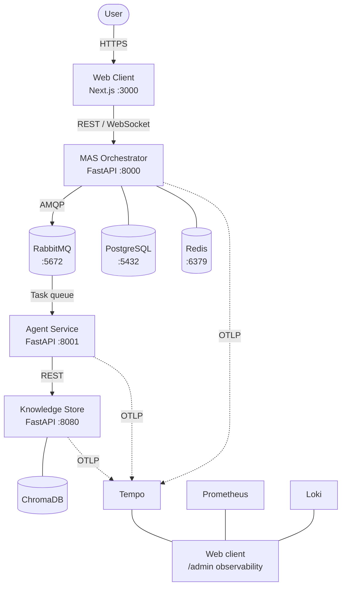

# Horus AI

[](https://github.com/EpitechPromo2027/G-EIP-600-BAR-6-1-eip-loup.marquez/actions/workflows/ci.yml)
[](https://www.python.org/)
[](LICENSE)

> **Coverage:** every CI run posts a per-service coverage table to its [Workflow Summary](https://github.com/EpitechPromo2027/G-EIP-600-BAR-6-1-eip-loup.marquez/actions/workflows/ci.yml) page and uploads the full clickable HTML report as a downloadable artifact (`coverage-mas`, `coverage-agent`, `coverage-knowledge-store`). Open the latest successful run → Summary tab → coverage table at the top, or scroll to Artifacts to download.

A self-hosted multi-agent orchestration platform that enables secure, private, and scalable AI deployments. Multiple specialized AI agents collaborate in real time, grounding their responses in your company's own documents through Retrieval-Augmented Generation (RAG).

## Architecture



## Technology Stack

| Layer | Technologies |
|-------|-------------|
| Frontend | TypeScript, Next.js 16, React 19, Tailwind CSS, Mantine, Radix UI |
| Backend | Python 3.13, FastAPI, SQLAlchemy 2, Alembic, Pydantic |
| AI / ML | LangChain, ChromaDB, SentenceTransformers, Hugging Face Transformers |
| Messaging | RabbitMQ (pika) |
| Data | PostgreSQL, Redis |
| Observability | Prometheus, Loki, Tempo, OpenTelemetry (viewed in the web client's `/admin` pages) |
| Auth | JWT + bcrypt, OAuth2 password flow, four-tier RBAC |
| Testing | pytest, Vitest, Playwright, Locust |
| CI/CD | GitHub Actions |

## Repository Structure

```
src/
  infra/                  Docker Compose, configs, .env
  services/
    mas/                  MAS orchestrator (FastAPI)
    agent/                AI agent service (FastAPI)
    knowledge-store/      Document store + vector search (FastAPI + ChromaDB)
    web-client/           Dashboard (Next.js)
tests/                    Python pytest suites (MAS, agent, knowledge-store)
scripts/                  Benchmarks, load tests, resilience tests, demo
demo_assets/              Mock corpus used during live demos
docs/                     Project documentation (MkDocs site)
  getting-started.md      Onboarding, configuration, troubleshooting
  architecture.md         System design + per-service deep dives
  api-reference.md        MAS, Knowledge Store, WebSocket APIs
  operations.md           Deployment, monitoring, secrets, env matrix
  security.md             RBAC, audit, data protection, telemetry
  contributing.md         Code style
  demo.md                 Live-demo script + cheatsheet + action plan
  adr/                    Architecture decision records (one per file)
  assets/                 Presentations + research PDFs
  ip_protection/          Signed NDAs and IP deposit proof (NOT published)
  archive/                Frozen historical docs (sprint notes, old plans)
greenlight/               EIP greenlight deliverables (deck, reports, code-quality review)
.github/workflows/        CI pipeline
```

## Prerequisites

- **Docker** (v20.10+) and **Docker Compose** 2.33.0 or newer (`docker compose version`; the installer refuses older ones)
- Optional: Python 3.13+ (local development without Docker)
- Optional: Node.js 20+ (web client development)

## Quickstart

```bash
git clone https://github.com/EpitechPromo2027/G-EIP-600-BAR-6-1-eip-loup.marquez.git
cd G-EIP-600-BAR-6-1-eip-loup.marquez/src/infra
cp .env.example .env
docker compose up --build
```

A first install takes 1.5 to 2 hours: the images download and build, then the language models download on first start. Subsequent starts are much faster.

That is the contributors' path. The beta installer (`START-HERE` in the ZIP, `installer/horus_install.py` here) builds nothing: it pulls the prebuilt, signed images that [`.github/workflows/images.yml`](.github/workflows/images.yml) publishes to a private registry, signing Docker in with the access token a tester was given. `--build-from-source` makes it build like the commands above. See [docs/operations.md](docs/operations.md#prebuilt-images).

## Service Ports

| Service | URL | Notes |
|---------|-----|-------|
| Web Client | http://localhost:3000 | Dashboard, chat, knowledge store UI |
| MAS API | http://localhost:8000 | Orchestrator REST API |
| MAS Swagger | http://localhost:8000/docs | Interactive API docs |
| Agent | http://localhost:8001 | Agent service |
| Knowledge Store | http://localhost:8080 | Document upload and search |
| KS Swagger | http://localhost:8080/docs | KS API docs (`root_path` is only for proxies) |
| RabbitMQ UI | http://localhost:15672 | guest / guest |
| PgAdmin | http://localhost:5433 | admin@admin.com / admin |
| Observability | http://localhost:3000/admin/logs · /admin/metrics · /admin/traces | admin role (in-app); replaces Grafana |
| RedisInsight | http://localhost:5540 | |

## Running Tests

```bash
# Python (from repository root; each service has its own pytest.ini pythonpath)
pytest -c tests/mas/pytest.ini tests/mas --ignore=tests/mas/test_integration.py -vv
pytest -c tests/mas/pytest.ini tests/mas/test_integration.py -vv   # needs MAS on :8000
pytest -c tests/agent/pytest.ini tests/agent -vv
pytest -c tests/knowledge_store/pytest.ini tests/knowledge_store -vv
# Or run all three: ./scripts/test/run-all.sh

# Web Client tests
cd src/services/web-client && npm test

# Load tests (requires running services)
cd scripts/perf && locust -f load-locust.py
```

## GPU Support

`docker-compose.yml` requests **`gpus: all`** for four services — **`mas`** (orchestrator LLM), **`agent`** (decision / RAG model), **`vllm`** (the AWQ 4B server) and **`knowledge_store`** (embeddings) — when the [NVIDIA Container Toolkit](https://docs.nvidia.com/datacenter/cloud-native/container-toolkit/install-guide.html) is installed (Docker Desktop on Windows: WSL2 + GPU drivers).

- Keep **`LLM_FORCE_CPU=0`** (default) so MAS uses CUDA when visible.
- If you have **no GPU**, use the CPU overlay `src/infra/docker-compose.cpu.yml` (the installer's `cpu-*` profiles do this for you). It drops the `gpus` requests and replaces vLLM with one llama-server, the `llm` service, that serves Qwen3-4B Q4_K_M to MAS and every agent; point both at it with `LLM_VLLM_URL=http://llm:8080/v1`. The model file is listed in [`models/manifest.json`](models/manifest.json); the installer downloads it into `models/`, and without the installer the one-shot `llm-model` service fetches it there. See [docs/operations.md](docs/operations.md#the-cpu-model-server) and [scripts/models/README.md](scripts/models/README.md).
- Without a usable NVIDIA GPU, Docker needs at least 13.5 GiB of memory (`cpu-lean`; 15.0 GiB for `cpu-standard`). These are planning figures from [ADR-006](docs/adr/ADR-006-low-ram-machines.md), kept until the run on the 16 GB reference machine. Below that the installer stops before any large download and says what to change; on Windows Docker gets half of the RAM unless WSL is given more. A first run on a development laptop is recorded in the ADR and in `benchmarks/cpu-laptop-2026-10-06.json`: by the ADR's rule it gives 10.5 GiB for `cpu-standard`, to confirm on the reference machine. See [docs/operations.md](docs/operations.md#hardware-decision).

## Documentation

Full documentation lives under [`docs/`](docs/) and is published as a browsable site via MkDocs. One file per topic — use Ctrl+F inside.

**Engineering docs**

| Topic | Link |
|-------|------|
| Getting Started (onboarding, config, troubleshooting) | [docs/getting-started.md](docs/getting-started.md) |
| Architecture (overview, services, data model, fiche) | [docs/architecture.md](docs/architecture.md) |
| API Reference (MAS, Knowledge Store, WebSocket) | [docs/api-reference.md](docs/api-reference.md) |
| Operations (deployment, monitoring, secrets, env) | [docs/operations.md](docs/operations.md) |
| Security & Compliance (RBAC, audit, data, telemetry) | [docs/security.md](docs/security.md) |
| Contributing (agreement, branches, commits, pull requests) | [CONTRIBUTING.md](CONTRIBUTING.md) |
| Code style | [docs/contributing.md](docs/contributing.md) |
| Demo (script, cheatsheet, action plan) | [docs/demo.md](docs/demo.md) |
| Changelog (commit log, monthly) | [CHANGELOG.md](CHANGELOG.md) |
| Beta test plan | [beta_test_plan.md](beta_test_plan.md) |
| ADRs (individual decision records) | [docs/adr/](docs/adr/) |
| Research papers + slides | [docs/assets/](docs/assets/) |

**EIP Tech 4 deliverables** — everything the jury looks at, grouped under [`docs/eip/`](docs/eip/):

| Topic | Link |
|-------|------|
| **Index** (start here) | [docs/eip/README.md](docs/eip/README.md) |
| Objectives audit (scorecard) | [docs/eip/objectives-audit.md](docs/eip/objectives-audit.md) |
| Performance — KPIs, benchmarks, before/after (Point D) | [docs/eip/performance.md](docs/eip/performance.md) |
| Tech Watch (Point 1) | [docs/eip/tech-watch.md](docs/eip/tech-watch.md) |
| Community Contributions (Point 1) | [docs/eip/community-contributions.md](docs/eip/community-contributions.md) |
| Protection Plan (Point A) | [docs/eip/protection-plan.md](docs/eip/protection-plan.md) |
| Diffusion Strategy (Point A) | [docs/eip/diffusion-strategy.md](docs/eip/diffusion-strategy.md) |

## Generating Browsable Documentation

A single script builds all project documentation into a browsable HTML site:

```bash
# Install prerequisites (once)
pip install mkdocs mkdocs-material mkdocs-mermaid2-plugin pdoc
cd src/services/web-client && npm install --save-dev typedoc && cd -

# Generate and open in browser
./scripts/docs.sh

# Or start a live-reload server
./scripts/docs.sh --serve
```

This generates three layers of documentation:
- **MkDocs site** -- all Markdown docs (architecture, API reference, guides) with Mermaid diagrams
- **pdoc HTML** -- Python API reference auto-generated from docstrings (MAS, Agent, Knowledge Store)
- **TypeDoc HTML** -- TypeScript API reference auto-generated from TSDoc (Web Client)

## Contributing

All work starts as a GitHub issue, and contributions need a signed Horus Contributor Agreement. [CONTRIBUTING.md](CONTRIBUTING.md) says how to get one and how to send a change: branches, commits, pull requests and tests.

## License

Horus is **closed-source, proprietary software** (all rights reserved). Having access to this repository or to a Horus build gives no right to use, copy or distribute it: every use requires a signed agreement with the licensors (commercial licence, evaluation licence or contributor agreement).

- Terms: [LICENSE](LICENSE) (Horus Proprietary Software Licence v2, 30/09/2026)
- Why Horus is closed source: [ADR-004](docs/adr/ADR-004-closed-source-licence.md)
- Third-party open-source components keep their own licences: [dependency licence inventory](docs/eip/dependency-licence-inventory.xlsx)
- Contributions are accepted only under a signed Contributor Agreement ([LICENSE](LICENSE), section 9).

## Authors

- **Loup Marquez** -- loup.m.marquez@gmail.com
- **Matheus Lopez** -- matheus.lopez@epitech.eu
- **Noah Gibelli** -- noah.gibelli@epitech.eu

What each of us built, and the external contributors: [CONTRIBUTORS.md](CONTRIBUTORS.md).
