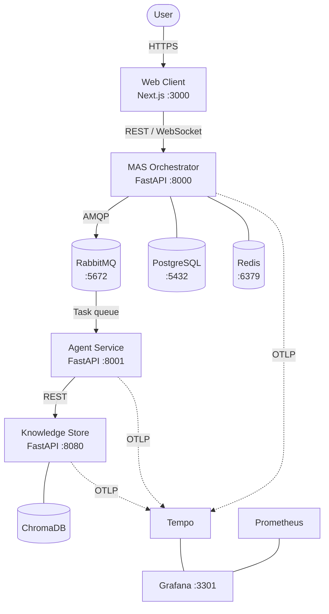

# Horus AI

A self-hosted multi-agent orchestration platform that enables secure, private, and scalable AI deployments. Multiple specialized AI agents collaborate in real time, grounding their responses in your company's own documents through Retrieval-Augmented Generation (RAG).

## Architecture



## Technology Stack

| Layer | Technologies |
|-------|-------------|
| Frontend | TypeScript, Next.js 16, React 19, Tailwind CSS, Mantine, Radix UI |
| Backend | Python 3.13, FastAPI, SQLAlchemy 2, Alembic, Pydantic |
| AI / ML | LangChain, ChromaDB, SentenceTransformers, Hugging Face Transformers |
| Messaging | RabbitMQ (pika) |
| Data | PostgreSQL, Redis |
| Observability | Prometheus, Grafana, OpenTelemetry, Tempo |
| Auth | JWT + bcrypt, OAuth2 password flow, four-tier RBAC |
| Testing | pytest, Vitest, Playwright, Locust |
| CI/CD | GitHub Actions |

## Repository Structure

```
src/
  infra/                  Docker Compose, configs, .env
  services/
    mas/                  MAS orchestrator (FastAPI)
    agent/                AI agent service (FastAPI)
    knowledge-store/      Document store + vector search (FastAPI + ChromaDB)
    web-client/           Dashboard (Next.js)
tests/                    Python pytest suites (MAS, agent, knowledge-store)
docs/                     Project documentation
scripts/                  Benchmarks, load tests, resilience tests, demo
.github/workflows/        CI pipeline
```

## Prerequisites

- **Docker** (v20.10+) and **Docker Compose** (v2+)
- Optional: Python 3.11+ (local development without Docker)
- Optional: Node.js 20+ (web client development)

## Quickstart

```bash
git clone https://github.com/EpitechPromo2027/G-EIP-600-BAR-6-1-eip-loup.marquez.git
cd G-EIP-600-BAR-6-1-eip-loup.marquez/src/infra
cp .env.example .env
docker compose up --build
```

First build takes 10-15 minutes. Subsequent starts are much faster.

## Service Ports

| Service | URL | Notes |
|---------|-----|-------|
| Web Client | http://localhost:3000 | Dashboard, chat, knowledge store UI |
| MAS API | http://localhost:8000 | Orchestrator REST API |
| MAS Swagger | http://localhost:8000/docs | Interactive API docs |
| Agent | http://localhost:8001 | Agent service |
| Knowledge Store | http://localhost:8080 | Document upload and search |
| KS Swagger | http://localhost:8080/docs | KS API docs (`root_path` is only for proxies) |
| RabbitMQ UI | http://localhost:15672 | guest / guest |
| PgAdmin | http://localhost:5433 | admin@admin.com / admin |
| Grafana | http://localhost:3301 | admin / admin |
| RedisInsight | http://localhost:5540 | |

## Running Tests

```bash
# Python (from repository root; each service has its own pytest.ini pythonpath)
pytest -c tests/mas/pytest.ini tests/mas --ignore=tests/mas/test_integration.py -vv
pytest -c tests/mas/pytest.ini tests/mas/test_integration.py -vv   # needs MAS on :8000
pytest -c tests/agent/pytest.ini tests/agent -vv
pytest -c tests/knowledge_store/pytest.ini tests/knowledge_store -vv
# Or run all three: ./scripts/ci/run_all_python_tests.sh

# Web Client tests
cd src/services/web-client && npm test

# Load tests (requires running services)
cd scripts/load_tests && locust -f locustfile.py
```

## GPU Support

`docker-compose.yml` requests **`gpus: all`** for **`mas`** (orchestrator LLM), **`agent`** (decision / RAG model), and **`knowledge_store`** (embeddings) when the [NVIDIA Container Toolkit](https://docs.nvidia.com/datacenter/cloud-native/container-toolkit/install-guide.html) is installed (Docker Desktop on Windows: WSL2 + GPU drivers).

- Keep **`LLM_FORCE_CPU=0`** (default) so MAS uses CUDA when visible.
- If you have **no GPU** or Compose errors on startup, **comment out** the `gpus: all` lines under those three services in `src/infra/docker-compose.yml`, and set **`MODEL_DEVICE=cpu`** and **`LLM_FORCE_CPU=1`** in `src/infra/.env` as needed.

## Documentation

| Topic | Link |
|-------|------|
| Developer onboarding | [docs/onboarding.md](docs/onboarding.md) |
| Architecture | [docs/architecture.md](docs/architecture.md) |
| Configuration | [docs/configuration.md](docs/configuration.md) |
| Deployment | [docs/deployment.md](docs/deployment.md) |
| Monitoring | [docs/monitoring_manual.md](docs/monitoring_manual.md) |
| RBAC and permissions | [docs/rbac.md](docs/rbac.md) |
| Secrets management | [docs/secrets-management.md](docs/secrets-management.md) |
| Testing policy | [docs/testing_policy.md](docs/testing_policy.md) |
| Troubleshooting | [docs/troubleshooting.md](docs/troubleshooting.md) |

## Generating Browsable Documentation

A single script builds all project documentation into a browsable HTML site:

```bash
# Install prerequisites (once)
pip install mkdocs mkdocs-material mkdocs-mermaid2-plugin pdoc
cd src/services/web-client && npm install --save-dev typedoc && cd -

# Generate and open in browser
./scripts/generate_docs.sh

# Or start a live-reload server
./scripts/generate_docs.sh --serve
```

This generates three layers of documentation:
- **MkDocs site** -- all Markdown docs (architecture, API reference, guides) with Mermaid diagrams
- **pdoc HTML** -- Python API reference auto-generated from docstrings (MAS, Agent, Knowledge Store)
- **TypeDoc HTML** -- TypeScript API reference auto-generated from TSDoc (Web Client)

## Contributing

All work must start as a GitHub Issue. See [docs/contributing/contributing.md](docs/contributing/contributing.md) for branch naming, commit conventions, code style, and pull request guidelines.

## License

This software is proprietary. Use requires a valid commercial license agreement. See [LICENSE](LICENSE) for details.

## Authors

- **Loup Marquez** -- loup.m.marquez@gmail.com
- **Matheus Lopez** -- matheus.lopez@epitech.eu
- **Noah Gibelli** -- noah.gibelli@epitech.eu
