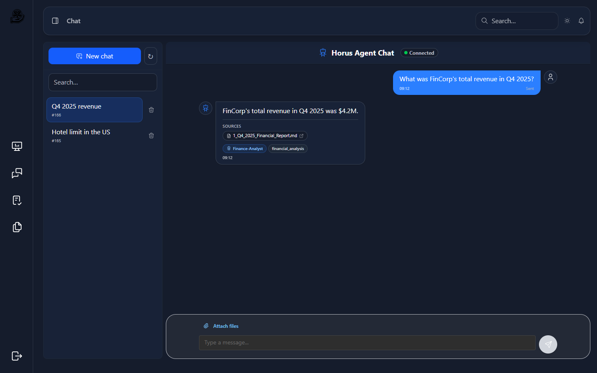
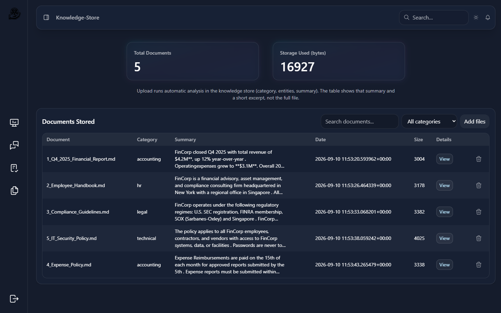
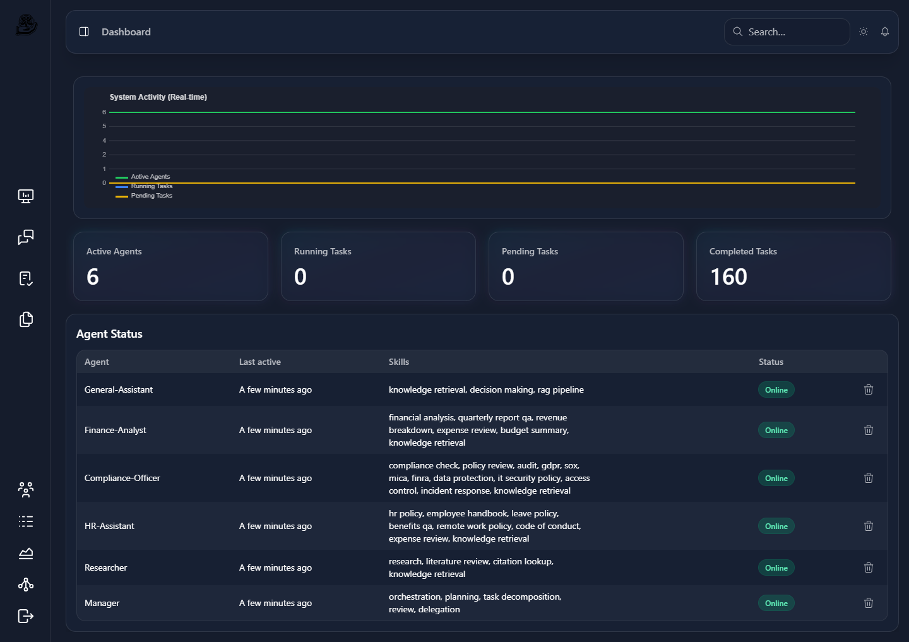
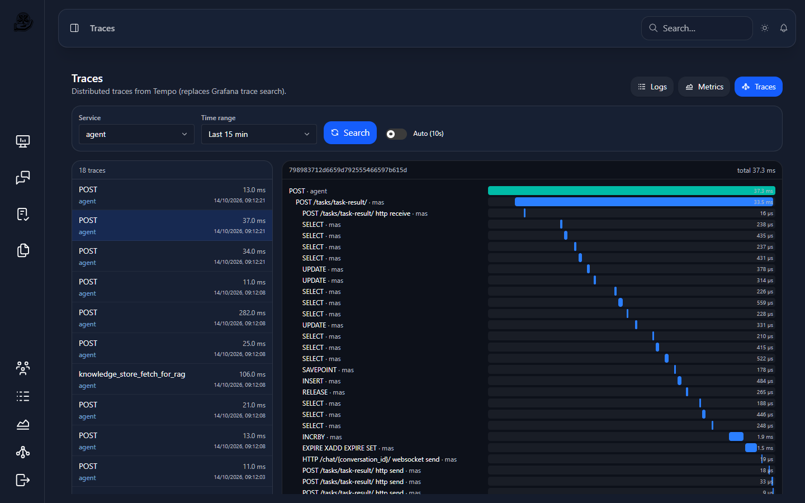
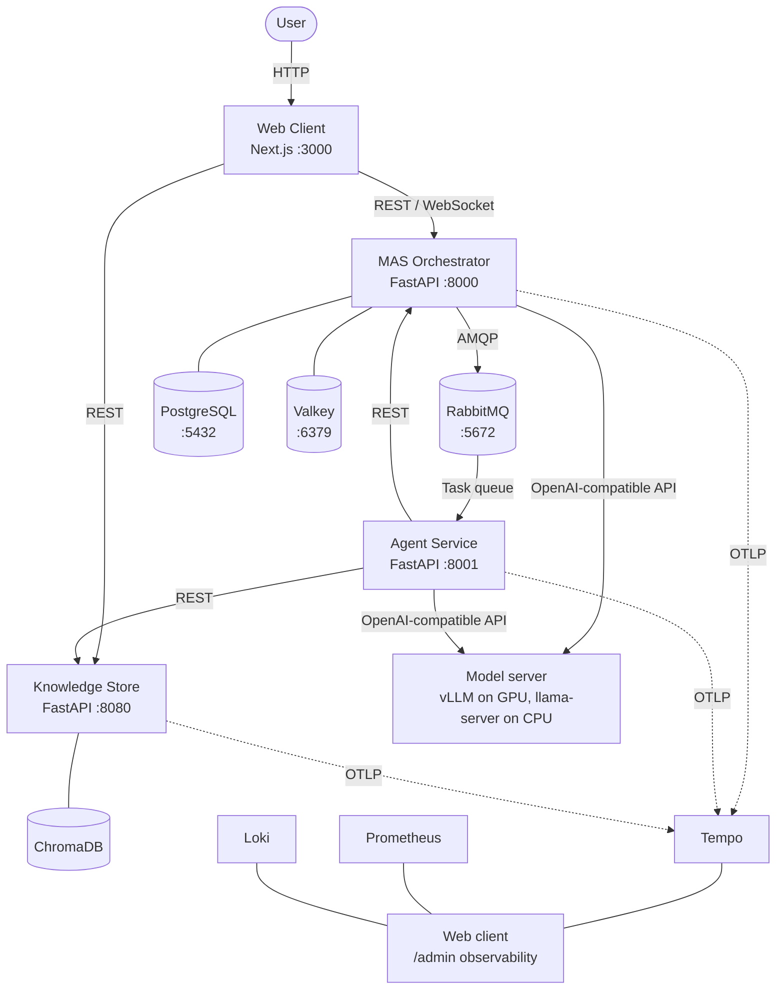

# Horus AI

[](https://github.com/Horus-EIP/horus/actions/workflows/ci.yml)
[](https://www.python.org/)
[](LICENSE)

Horus answers questions about your organisation's documents. It runs on your own machine in Docker: specialised AI agents search the documents you give it and answer from them, citing the documents they used. An installer picks a setup that fits your hardware, from an NVIDIA GPU down to a CPU-only machine.

What Horus is not:

- **Not a cloud service.** Nothing is hosted for you. Horus runs on your machine and your documents stay there. The install downloads the container images and the language model once.
- **Not a general chatbot.** It is built to answer from the documents you give it.
- **Not open source.** Horus is proprietary. Using it needs a signed agreement; only its benchmark and evaluation kit is open source (see [License](#license)).
- **Not finished.** Horus is a beta for invited testers. Its version is in `VERSION`.

## What it looks like



A question about the demo documents: the agents search them and answer, citing the documents they used.



The knowledge store. Each document added gets a category, its entities and a summary.



The dashboard: the agents online, their skills, and the tasks.



For admins, the logs, metrics and traces of the whole stack, inside the web client. Here, one trace across the agent and MAS: the agent handing back an answer, down to each database call.

Taken on 14/10/2026 with Horus 0.1.2, local mode, `cpu-standard` profile (Qwen3-4B-Instruct-2507, Q4_K_M), with the five documents in `demo_assets/`.

## Requirements

| | |
|---|---|
| Docker | Docker Desktop or Docker Engine, running, with **Docker Compose 2.33.0 or newer** (`docker compose version`). The installer stops on an older Compose. |
| Python | 3.11 or newer, only to run the installer. |
| Free disk | **150 GB**. The installer checks this and stops below it. With an NVIDIA GPU 125 GB is enough: re-run with `--skip-disk-check`. It settles to about 130 GB (CPU) or 110 GB (GPU) after the install. These figures were measured when the images were built on a tester's machine; the download of the prebuilt images has not been measured yet. |
| With an NVIDIA GPU | Docker must be able to use the card (NVIDIA Container Toolkit; on Windows, WSL 2 and the NVIDIA driver). At least 6.0 GiB of VRAM. The installer picks `gpu-8g` from 6.0 to under 10.0 GiB, `gpu-16g` from 10.0 to under 17.0, `gpu-24g` from 17.0 to under 25.0, and `gpu-large` from 25.0. Only `gpu-8g` has been measured. AMD and Intel GPUs, and every Mac, run on the CPU. |
| Without a usable NVIDIA GPU | Memory Docker can use: **15.0 GiB** or more for `cpu-standard`, **13.5 to under 15.0 GiB** for `cpu-lean`. Under 13.5 GiB the installer stops before any large download and says what to change. On Windows Docker gets half of the RAM unless WSL is given more, so in practice that takes a 24 GB machine. These are the planning figures of [ADR-006](docs/adr/ADR-006-low-ram-machines.md), kept until the run on the 16 GB reference machine. A first run on a development laptop gives 10.5 GiB for `cpu-standard` by the ADR's rule. |
| Mock AI mode | No GPU and no model download: **3.0 GiB** of memory for Docker and **12 GiB** of free disk (23 GiB with `--build-from-source`). The answers and the search are simulated, so it is for demos and tests ([Mock AI mode](#mock-ai-mode-horus-without-any-ai-model)). |
| Time | A first install that built the images took 1.5 to 2 hours. The beta installer downloads prebuilt images instead; that has not been timed yet. |

The prebuilt images are built for x86-64 only. On Apple Silicon Docker runs them through emulation.

## Install

### Testers: the beta bundle

You need the Horus-Beta ZIP and the access token we sent you.

1. Extract the whole ZIP into a folder.
2. Save the token in that folder as `registry-token.txt`, on one line: `USERNAME:TOKEN`.
3. Run the START-HERE file for your system:
   - Windows: double-click `START-HERE-Windows.bat`
   - macOS: right-click `START-HERE-macOS.command` and choose Open
   - Linux: `./START-HERE-Linux.sh`

The START-HERE files run `installer/horus_install.py`. It checks Docker, Compose, the disk, the network and the ports, picks a profile for your hardware, asks which folders Horus may read (read-only), downloads the prebuilt images and the model, and starts everything. It does not build anything. When it finishes, open http://localhost:3000 and sign in with the user name and password it prints.

- To see which profile it would pick without changing anything: `--dry-run`.
- To stop and keep your data: run your START-HERE file with `--stop`. To remove everything: `--uninstall` (this deletes the documents you added).
- If something goes wrong, send us `install-log.txt` and `horus-profile.json` from the same folder.

The full tester notes are in [packaging/README-FIRST.txt](packaging/README-FIRST.txt).

### Contributors: from the repository

Contributions need a signed Contributor Agreement first (see [Contributing](#contributing)).

The simplest way is the installer, which picks the profile and writes `src/infra/.env` for you, then builds the images on your machine:

```bash
git clone https://github.com/Horus-EIP/horus.git
cd horus
python installer/horus_install.py --build-from-source
```

Or, on a machine with an NVIDIA GPU, with Docker Compose directly:

```bash
cd src/infra
./init-env.sh             # creates .env from .env.example with a random JWT secret and Valkey password
docker compose up --build
```

Without a GPU the stack needs the CPU overlay (`docker-compose.cpu.yml`) and the CPU settings in `.env`: the model server URL `http://llm:8080/v1`, longer timeouts and a context size. The installer writes them; `python installer/horus_install.py --dry-run` prints them. The model file is listed in [`models/manifest.json`](models/manifest.json): the installer downloads it into `models/`, and without the installer the one-shot `llm-model` service fetches it ([the CPU model server](docs/operations.md#the-cpu-model-server)). See also [docs/getting-started.md](docs/getting-started.md) and [docs/operations.md](docs/operations.md#local-deployment-with-docker).

### Mock AI mode: Horus without any AI model

On a machine that cannot run the models, for a demo, or to test everything but the AI, Horus can run in mock AI mode. No AI model runs at all. A small server, `llm-mock`, takes the place of the model server: it answers from the documents the knowledge store retrieved, with their sources, or says it does not have the information, and it computes the embeddings MAS and the knowledge store search with from the words of each text, so search is word matching. spaCy is off, and so is monitoring (Prometheus, Loki, Tempo, Alloy) unless `HORUS_MONITORING=on`. Sign-in, tasks and the rest are real, but **the answers and the search are simulated**: never judge Horus's answers or search by them. The web client shows a banner and a **Simulated** badge on each answer, and the desktop app shows `AI: Mock`.

- Switch an install: run your START-HERE file with `--ai mock`, `--ai local` or `--ai status`. A switch says how many documents it will re-embed, asks first above 100, restarts Horus, waits for the re-embedding, runs the smoke test and rolls back if it fails.
- Install in mock mode: `--profile mock`. On a machine under the minimum, an interactive install offers it.
- By hand: add `docker-compose.mock.yml` after `docker-compose.cpu.yml` in `COMPOSE_FILE`, then `docker-compose.monitoring-off.yml` to turn monitoring off.
- Settings: `HORUS_MONITORING`, and the ones the mock overlay sets (`MAS_EMBED_URL`, `KNOWLEDGE_STORE_EMBED_URL` and their `_MODEL`, `HORUS_SPACY`), which a local install can use too; see `src/infra/.env.example`.

CI runs the whole stack this way on every push (`e2e-mock`). How it works and its settings: [docs/mock-ai.md](docs/mock-ai.md) and [ADR-008](docs/adr/ADR-008-mock-ai-mode.md).

## Measured results

The 100-question test set (`tests/eval/testset.yaml`, version 1.0.0, over the five documents in `demo_assets/`), run on 2026-10-06 on a development laptop: AMD Ryzen AI 9 HX 370 (12 cores, AVX2), 64 GB of LPDDR5-7500, Docker Desktop on WSL 2 with 31 GiB. The GPU run used its NVIDIA GeForce RTX 4070 Laptop GPU (8 GB).

| Profile | Model server | Questions | Answers correct | Median time per answer |
|---|---|---:|---:|---:|
| `cpu-standard` | llama-server, Qwen3-4B-Instruct-2507 Q4_K_M | 100 | 93 | 18.2 s |
| `cpu-lean` | llama-server, same model, 4,096-token context, q8_0 KV cache | first 30 | 29 | 33.2 s |
| `gpu-8g` | vLLM, Qwen3-4B-Instruct-2507 AWQ | 100 | 96 | 2.97 s |

On the same first 30 questions `cpu-standard` got 28 right, with a median of 17.7 s. Answers are checked automatically; the two-reviewer check has not been done yet. This is not the 16 GB reference machine. The reports and how to run them: [benchmarks/README.md](benchmarks/README.md).

## Architecture



## Technology stack

| Layer | Technologies |
|-------|-------------|
| Frontend | TypeScript, Next.js 16, React 19, Tailwind CSS 4, Mantine 8 |
| Backend | Python 3.11 in the service images, FastAPI, SQLAlchemy 2, Alembic, Pydantic |
| Language model | Qwen3-4B-Instruct-2507: vLLM 0.23.0 (AWQ) on an NVIDIA GPU, llama.cpp llama-server b11382 (Q4_K_M GGUF) on the CPU |
| Retrieval | ChromaDB 1.5.2, FastEmbed 0.8.1 on ONNX Runtime (BAAI/bge-base-en-v1.5 in the knowledge store, all-MiniLM-L6-v2 for MAS routing), LangChain tools in the agent |
| Messaging | RabbitMQ 4.1 (pika) |
| Data | PostgreSQL, Valkey 9.1 (Redis protocol; the Compose service is still called `redis`) |
| Observability | Prometheus, Loki fed by Grafana Alloy, Tempo, OpenTelemetry (viewed in the web client's `/admin` pages) |
| Auth | JWT + bcrypt, OAuth2 password flow, four roles (admin, manager, user, system) |
| Install | Python installer (`installer/`), Tauri desktop app (`desktop/`) |
| Testing | pytest, Vitest, Locust ([TESTING.md](TESTING.md)) |
| CI/CD | GitHub Actions: service and installer tests on the images' Python (`src/services/PYTHON_VERSION`, 3.11.17), signed release images, desktop release |

## Repository structure

```
src/
  infra/                  Docker Compose files (GPU base, CPU and mock overlays), configs, .env.example
  services/
    mas/                  MAS orchestrator (FastAPI)
    agent/                AI agent service (FastAPI)
    knowledge-store/      Document store + vector search (FastAPI + ChromaDB)
    web-client/           Dashboard (Next.js)
    llm-mock/             Mock model server of mock AI mode (Python standard library)
installer/                Beta installer: hardware profiles, preflight, model download
packaging/                START-HERE scripts, README-FIRST.txt, release notes, bundle builder
desktop/                  Desktop app (Tauri) that starts and stops Horus
opensource/               The benchmark and evaluation kit (Apache-2.0), a copy of Horus-EIP/horus-bench-kit
models/                   Model manifest; the CPU model file lands here
benchmarks/               Measured results (JSON) and how to produce them
tests/                    pytest suites (MAS, agent, knowledge store, CI wiring) and the eval test set
scripts/                  Benchmarks, evaluation, load and resilience tests, integration checks
demo_assets/              The sample documents used by demos and the test set
docs/                     Project documentation (MkDocs site); adr/ holds the decision records
LICENSES/, NOTICES/       Licence texts and NOTICE files of the third-party components
.github/workflows/        CI, eval test set, release images, desktop release
```

## Service ports

| Service | URL | Notes |
|---------|-----|-------|
| Web Client | http://localhost:3000 | Dashboard, chat, knowledge store UI |
| MAS API | http://localhost:8000 | Swagger at `/docs` |
| Agent | http://localhost:8001 | |
| Knowledge Store | http://localhost:8080 | Swagger at `/docs` (`root_path` is only for proxies) |
| vLLM | http://localhost:18000 | GPU profiles only (`VLLM_HOST_PORT`). The CPU model server publishes no port |
| RabbitMQ UI | http://localhost:15672 | `RABBITMQ_USER` / `RABBITMQ_PASSWORD` in `.env` |
| PostgreSQL, Valkey, RabbitMQ (AMQP) | 5432, 6379, 5672 | `DB_PORT`, `REDIS_PORT`, `RABBITMQ_PORT` |
| Tempo (OTLP) | 4317 (gRPC), 4318 (HTTP) | |
| Observability | http://localhost:3000/admin/logs · /admin/metrics · /admin/traces | Admin role, in the web client |
| PgAdmin | http://localhost:5433 | Development tool, only with `docker compose --profile dev-tools up` |

Every port is published on 127.0.0.1, the web client's included, so Horus answers on this machine only; Prometheus, Loki, Tempo's query port and the CPU model server are not published at all. To reach the web client from other machines, set `HORUS_WEB_BIND=0.0.0.0` in `src/infra/.env`: the web client, its sign-in page and the MAS API behind it then answer on the network, but chat and the knowledge store still do not work from another machine. From scripts, use `127.0.0.1` rather than `localhost`: on Windows a client that tries `::1` first waits about 2 s per connection before it falls back to 127.0.0.1.

## Running tests

```bash
# Python, from the repository root (each service has its own pytest.ini)
pytest -c tests/mas/pytest.ini tests/mas -m "not requires_stack"
pytest -c tests/agent/pytest.ini tests/agent
pytest -c tests/knowledge_store/pytest.ini tests/knowledge_store
# Or all three: ./scripts/test/run-all.sh

# Web client
cd src/services/web-client && npm test

# Load tests (need a running stack)
cd scripts/perf && locust -f load-locust.py
```

Tests that need a running stack are in [scripts/integration-checks/](scripts/integration-checks/README.md). Every CI run posts a per-service coverage table to its Workflow Summary. A MAS, agent or knowledge-store test job that fails also uploads its coverage and junit reports, the HTML report included, as an artifact kept 3 days (`coverage-mas`, `coverage-agent`, `coverage-knowledge-store`); a green run uploads none.

## Test coverage

As CI measured it on 13/10/2026, in run #274 on `Sprint#1_September2026_Tek5` (commit `047fd47`):

| Suite | Lines | Lines and branches | Tests | CI gate |
|---|---:|---:|---|---:|
| MAS | 93.8 % | 92.69 % | 1691 passed, 2 skipped | 85 % |
| Agent | 94.8 % | 94.06 % | 811 passed, 2 skipped | 90 % |
| Knowledge store | 92.1 % | 90.72 % | 375 passed | 85 % |
| Installer | 79.3 % | 77.00 % | 779 passed, 9 skipped | none |
| LLM mock | 98.0 % | 97.40 % | 164 passed | 90 % |

Each CI run prints both figures in the summaries of its test jobs and gathers them in one table (job `coverage-summary`). Lines is the share of lines covered. Lines and branches counts both together (`--cov-branch`, see [TESTING.md](TESTING.md#coverage)): it is the figure a gate compares with its minimum, the same as the job log's `Total coverage`, and usually the lower of the two. The installer's tests have no gate.

## Documentation

Full documentation lives under [`docs/`](docs/) and is published as a browsable site with MkDocs.

| Topic | Link |
|-------|------|
| Getting started (onboarding, config, troubleshooting) | [docs/getting-started.md](docs/getting-started.md) |
| Architecture (overview, services, data model) | [docs/architecture.md](docs/architecture.md) |
| API reference (MAS, Knowledge Store, WebSocket) | [docs/api-reference.md](docs/api-reference.md) |
| Operations (deployment, hardware profiles, monitoring, secrets) | [docs/operations.md](docs/operations.md) |
| Mock AI mode (Horus without a language model) | [docs/mock-ai.md](docs/mock-ai.md) |
| Security and compliance (RBAC, audit, data, telemetry) | [docs/security.md](docs/security.md) |
| How to contribute | [CONTRIBUTING.md](CONTRIBUTING.md) |
| Code style | [docs/contributing.md](docs/contributing.md) |
| Test strategy | [TESTING.md](TESTING.md) |
| Versions and releases | [VERSIONING.md](VERSIONING.md) |
| Benchmarks | [benchmarks/README.md](benchmarks/README.md) |
| Demo (script, cheatsheet) | [docs/demo.md](docs/demo.md) |
| Changelog | [CHANGELOG.md](CHANGELOG.md) |
| Beta test plan | `beta_test_plan.md`, in the team's private repository |
| Decision records | [docs/adr/](docs/adr/) |
| EIP deliverables (start here for the jury) | [docs/eip/README.md](docs/eip/README.md) |

To build the site and the API references (pdoc, TypeDoc) into HTML:

```bash
pip install mkdocs mkdocs-material mkdocs-mermaid2-plugin pdoc
cd src/services/web-client && npm install --save-dev typedoc && cd -
./scripts/docs.sh            # or ./scripts/docs.sh --serve for live reload
```

## Contributing

All work starts as a GitHub issue, and contributions need a signed Horus Contributor Agreement. [CONTRIBUTING.md](CONTRIBUTING.md) says how to get one and how to send a change: branches, commits, pull requests and tests.

## License

Horus is **closed-source, proprietary software** (all rights reserved). Having access to this repository or to a Horus build gives no right to use, copy or distribute it: every use requires a signed agreement with the licensors (commercial licence, evaluation licence or contributor agreement).

- Terms: [LICENSE](LICENSE) (Horus Proprietary Software Licence v2.1, 08/10/2026)
- Why Horus is closed source: [ADR-004](docs/adr/ADR-004-closed-source-licence.md)
- `opensource/horus-bench-kit/`, our benchmark and evaluation kit, is under the Apache License 2.0, unlike the rest of the repository: section 1 of [LICENSE](LICENSE) leaves it out ([ADR-007](docs/adr/ADR-007-open-source-benchmark-kit.md)).
- Third-party components keep their own licences: [THIRD_PARTY_NOTICES](THIRD_PARTY_NOTICES) lists them (generated by `scripts/licences/third_party_notices.py`), and the dependency licence inventory (in the team's private repository) reviews them. Their full licence texts are in [LICENSES/](LICENSES/) and the NOTICE files they ship in [NOTICES/](NOTICES/); the release ZIP and every Horus image (in `/usr/share/doc/horus/`) carry all three
- Contributions are accepted only under a signed Contributor Agreement ([LICENSE](LICENSE), section 9).

## Authors

- **Loup Marquez** -- loup.marquez@epitech.eu
- **Matheus Lopez** -- matheus.lopez@epitech.eu
- **Noah Gibelli** -- noah.gibelli@epitech.eu

What each of us built, and the external contributors: [CONTRIBUTORS.md](CONTRIBUTORS.md).
