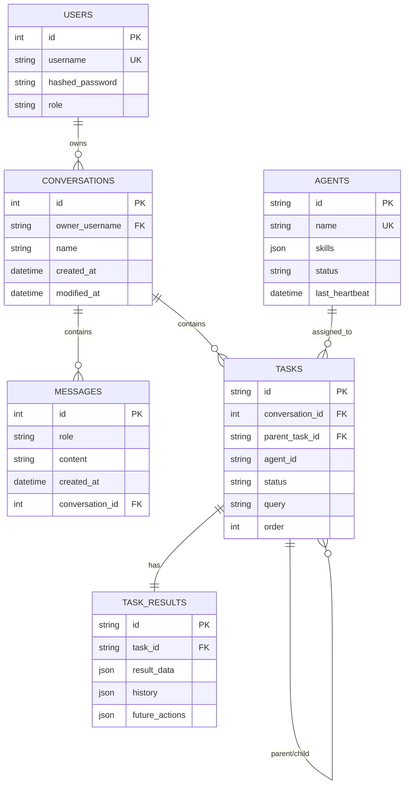
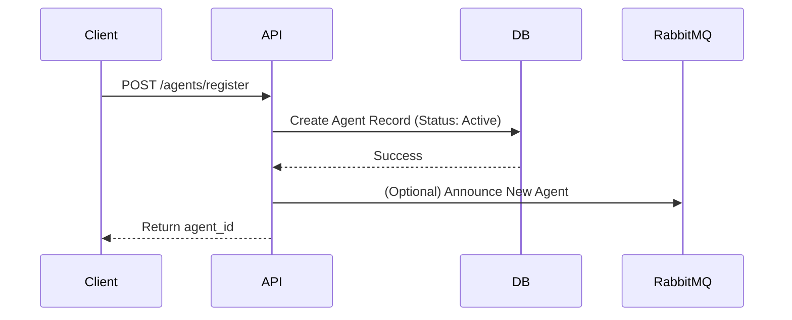
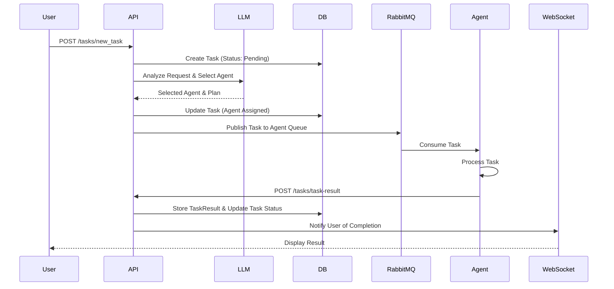

# Architecture Documentation

## 1. Persistence Topology

The persistence layer is built on PostgreSQL, using SQLAlchemy as the ORM. The schema is designed to support multi-agent orchestration, conversation history, and user management.

### Entity-Relationship Diagram (ERD)

## 2. Connection Lifecycle

The system manages connections to three primary infrastructure components: PostgreSQL, Redis, and RabbitMQ.

### PostgreSQL (Database)
- **Library:** `SQLAlchemy`
- **Lifecycle:**
  - A connection pool is initialized at application startup (`db.database.engine`).
  - **Pool Settings:** Size=10, Max Overflow=20, Timeout=30s, Recycle=1800s.
  - **Session Management:** A new `Session` is created for each request via the `get_db` dependency and closed immediately after the request completes.
  - **Monitoring:** Slow queries (>0.5s) are logged automatically.

### Redis (Cache & Pub/Sub)
- **Library:** `redis-py`
- **Lifecycle:**
  - Used for caching and potentially session management.
  - Connections are typically managed via a connection pool to ensure efficient resource usage.
  - **Configuration:** Host, Port, and Password are loaded from environment variables.

### RabbitMQ (Message Broker)
- **Library:** `pika`
- **Lifecycle:**
  - The `RabbitMQ` class in `core.rabbitmq_manager` handles connection logic.
  - **Retry Mechanism:** Implements a retry loop with exponential backoff (default 500 retries) for robust startup.
  - **Channels:** A channel is opened upon successful connection.
  - **Heartbeats:** Configured with a 600s heartbeat to maintain connection stability.

## 3. Configuration Contract

The application is configured via environment variables. These should be set in the deployment environment (e.g., `docker-compose.yml` or Kubernetes ConfigMaps).

| Category | Variable | Required | Description |
|----------|----------|----------|-------------|
| **Database** | `POSTGRES_USER` | Yes | Database username |
| | `POSTGRES_PASSWORD` | Yes | Database password |
| | `POSTGRES_DB` | Yes | Database name |
| | `DB_PORT` | Yes | Database port (e.g., 5432) |
| **Auth** | `JWT_SECRET_KEY` | Yes | Secret for signing tokens |
| | `JWT_ALGORITHM` | Yes | Algorithm (e.g., HS256) |
| **Admin** | `SUPER_USER_USERNAME` | Yes | Initial admin username |
| | `SUPER_USER_PASSWORD` | Yes | Initial admin password |
| **Redis** | `REDIS_HOST` | Yes | Redis hostname |
| | `REDIS_PORT` | Yes | Redis port |
| | `REDIS_PASSWORD` | Yes | Redis password |
| **RabbitMQ** | `RABBITMQ_HOST` | Yes | RabbitMQ hostname |
| | `RABBITMQ_PORT` | Yes | RabbitMQ port |
| | `RABBITMQ_USER` | Yes | RabbitMQ username |
| | `RABBITMQ_PASSWORD` | Yes | RabbitMQ password |
| **App** | `LLM_AUTOINIT` | No | Auto-initialize LLM (0/1) |

## 4. Sequence Diagrams

### Agent Registration Flow

### Task Dispatch & Execution Flow

## 5. Architecture Decision Records (ADR)

To view the detailed reasoning behind our technology choices, please refer to the following records:
- [ADR-001: RabbitMQ](architecture/ADR-001-rabbitmq.md)
- [ADR-002: ChromaDB](architecture/ADR-002-chromadb.md)
- [ADR-003: FastAPI](architecture/ADR-003-fastapi.md)
