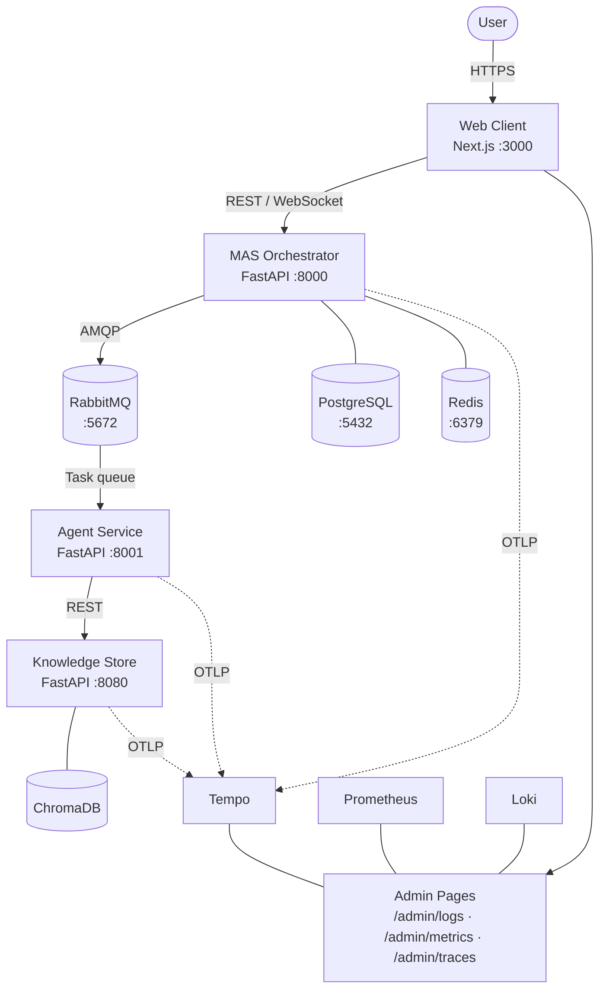
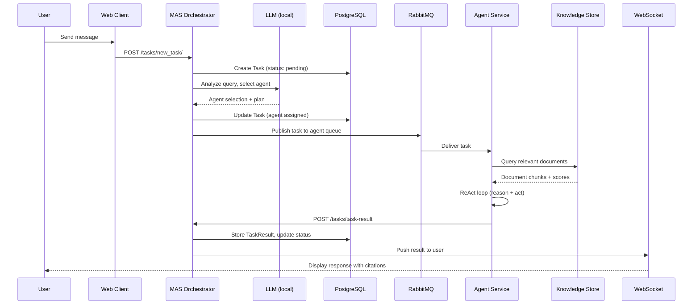
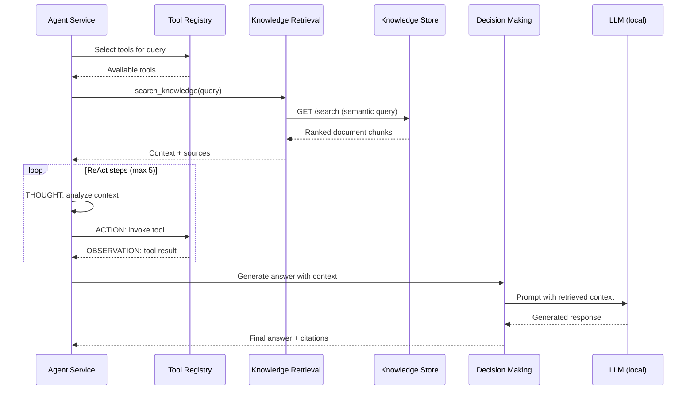
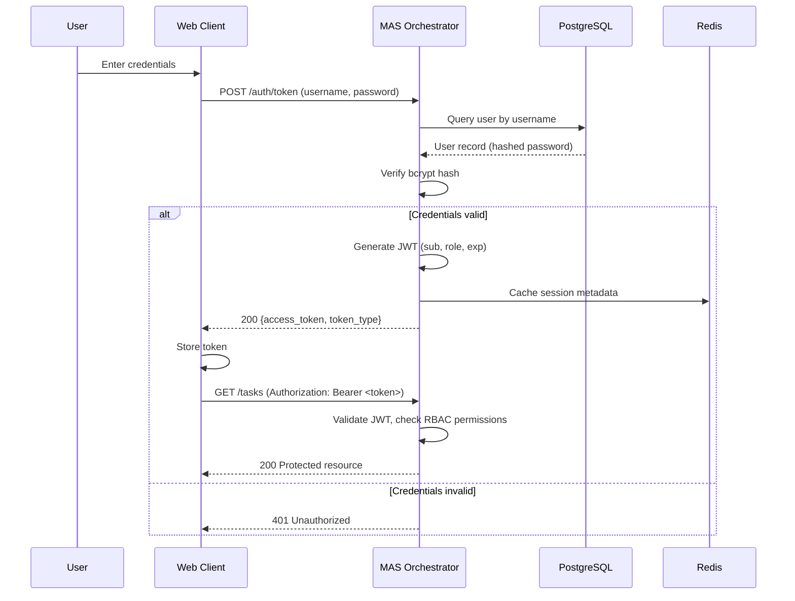
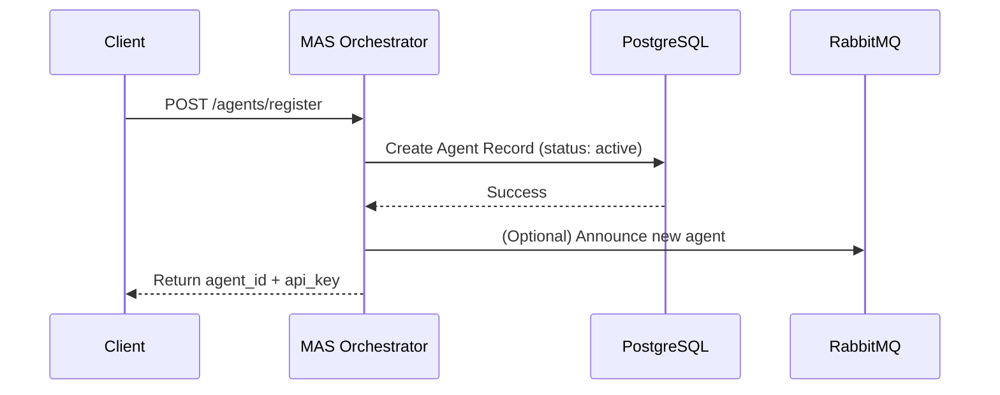
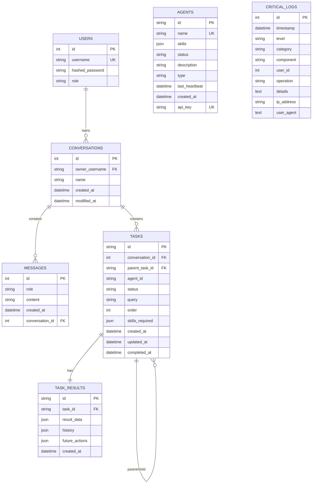

# Architecture

How Horus is built. Starts with the system overview, then drills into each service, then covers the data model, data extraction pipeline, the design of ephemeral conversation agents, and finally the architecture fiche prepared for compliance review.

---

## Horus AI -- Architecture Overview

### Table of Contents

1. [System Overview](#1-system-overview)
2. [High-Level Architecture](#2-high-level-architecture)
3. [Service Descriptions](#3-service-descriptions)
4. [Data Flow Diagrams](#4-data-flow-diagrams)
5. [Persistence Topology](#5-persistence-topology)
6. [Configuration Contract](#6-configuration-contract)
7. [Technology Stack](#7-technology-stack)

---

### 1. System Overview

**Horus AI** is a self-hosted, privacy-first AI orchestration platform that enables organizations to run a multi-agent system entirely on their own infrastructure. No data leaves the company's servers; no external APIs are required.

#### Problem

Organizations that want to leverage AI face three recurring concerns:

- **Data privacy** -- sensitive documents and queries are sent to third-party cloud services.
- **Cost** -- per-token pricing on commercial APIs scales unpredictably.
- **Vendor lock-in** -- tight coupling to a single provider limits flexibility and control.

#### Solution

Horus AI addresses all three by providing:

- A **local deployment model** using Docker Compose (NVIDIA GPU when the toolkit is installed; CPU fallback via env) where every component runs on-premise.
- A **multi-agent architecture** where specialized AI agents (researcher, analyst, writer) collaborate under a central orchestrator to answer user queries.
- A **Retrieval-Augmented Generation (RAG) pipeline** that grounds every response in the organization's own documents stored in a private vector database.
- A **real-time chat interface** for end users, backed by WebSocket communication and JWT-based authentication with four-tier role-based access control.

#### Key Capabilities

| Capability | Description |
|---|---|
| Private AI | All inference, storage, and orchestration run on-premise. |
| Multi-Agent Collaboration | Specialized agents are dispatched based on query analysis; tasks can be decomposed into sub-tasks. |
| RAG-Grounded Responses | Agents retrieve relevant document chunks from ChromaDB before generating answers, providing source citations. |
| Real-Time Chat | WebSocket-based streaming delivers responses to users as they are produced. |
| Role-Based Access Control | Four roles (Admin, Manager, User, System) with granular permissions govern every API endpoint. |
| Observability | Prometheus metrics, native admin observability pages in the web client (`/admin/metrics`, `/admin/logs`, `/admin/traces`), distributed tracing via OpenTelemetry/Tempo, and structured JSON logging with correlation IDs. |

---

### 2. High-Level Architecture

The platform is composed of four application services, three persistence stores, a message broker, and an observability stack.



#### Communication Protocols

| Path | Protocol | Purpose |
|---|---|---|
| User <-> Web Client | HTTPS | Browser traffic; static assets and API proxy |
| Web Client <-> MAS | REST (HTTP/1.1), WebSocket | API calls, real-time chat streaming |
| MAS <-> RabbitMQ | AMQP 0-9-1 | Asynchronous task dispatch and result delivery |
| RabbitMQ <-> Agent Service | AMQP 0-9-1 | Task consumption from dedicated queues |
| Agent Service <-> Knowledge Store | REST (HTTP/1.1) | Document search and file parsing requests |
| Knowledge Store <-> ChromaDB | ChromaDB Python client (embedded persistence in container) | Vector similarity search |
| All services -> Tempo | OTLP (gRPC) | Distributed trace export |
| Prometheus -> All services | HTTP scrape | Metrics collection |

---

### 3. Service Descriptions

#### 3.1 MAS Orchestrator

**Port:** 8000 | **Runtime:** Python 3.13, FastAPI, Uvicorn

The MAS (Multi-Agent System) orchestrator is the central brain of the platform. It receives every user request, authenticates and authorizes it, decomposes complex queries into sub-tasks, and dispatches each sub-task to the appropriate agent via RabbitMQ.

**Responsibilities:**

- User authentication (OAuth2 password flow, JWT tokens, bcrypt password hashing)
- Role-based access control with four roles: Admin, Manager, User, System
- Agent registry management (registration, heartbeat tracking, status monitoring)
- Task decomposition using LLM-assisted query analysis
- Task dispatch via RabbitMQ and result aggregation
- Conversation and message persistence
- Real-time WebSocket communication with the web client
- Audit logging to the `critical_logs` table

**Internal Architecture:**

| Module | Responsibility |
|---|---|
| `auth/` | Authentication, JWT issuance/validation, API key verification, RBAC permissions |
| `agents/` | Agent registration, discovery, and heartbeat monitoring |
| `tasks/` | Task lifecycle management, decomposition, dispatch, and result collection |
| `conversations/` | Conversation CRUD, message history |
| `chat/` | Real-time WebSocket handler and message routing |
| `users/` | User management endpoints |
| `db/` | SQLAlchemy models, session management, Redis client, migrations |
| `core/` | Configuration, logging, metrics, tracing, RabbitMQ connection management, middleware |
| `schemas/` | Pydantic request/response models |

#### 3.2 Agent Service

**Port:** 8001 | **Runtime:** Python 3.13, FastAPI, Uvicorn

The Agent Service hosts the AI agents that perform the actual reasoning and document retrieval. It consumes tasks from RabbitMQ, runs them through the RAG pipeline with a ReAct (Reasoning + Acting) loop, and posts results back to the MAS.

**Responsibilities:**

- Consuming tasks from RabbitMQ queues
- Running the RAG pipeline: knowledge retrieval, decision making, response generation
- ReAct agent loop (Thought -> Action -> Observation) for multi-step reasoning
- Tool execution: knowledge search, data extraction, file parsing, payment analysis, calculation, summarization
- Source citation in every response
- Posting task results back to the MAS orchestrator

**Internal Architecture:**

| Module | Responsibility |
|---|---|
| `agent_server/` | FastAPI app, task consumption endpoints, RabbitMQ listener |
| `ai_agents/rag_pipeline.py` | Orchestrates the full RAG flow: retrieval, reasoning, response |
| `ai_agents/react_agent.py` | ReAct loop with configurable max steps and timeout |
| `ai_agents/knowledge_retrieval_agent.py` | Queries the Knowledge Store for relevant document chunks |
| `ai_agents/decision_making_agent.py` | LLM-based decision making using retrieved context |
| `ai_agents/tool_registry.py` | Dynamic tool registration and dispatch |
| `ai_agents/calculator_tool.py` | Safe arithmetic evaluation |
| `ai_agents/data_extractor_tool.py` | Structured data extraction from documents |
| `ai_agents/file_parser_tool.py` | PDF, CSV, and text file parsing |
| `ai_agents/payment_analyzer_tool.py` | Domain-specific payment analytics |
| `ai_agents/summarizer_tool.py` | Text summarization |
| `ai_agents/knowledge_store_client.py` | HTTP client for the Knowledge Store API |
| `specialized/` | Pre-configured agent variants: researcher, analyst, writer |
| `config/` | Service-level configuration and model settings |
| `core/` | Logging, metrics, tracing |

#### 3.3 Knowledge Store

**Port:** 8080 | **Runtime:** Python 3.13, FastAPI, Uvicorn

The Knowledge Store is the organization's private memory. It ingests documents (PDF, DOCX, TXT, CSV, images), chunks and embeds them into ChromaDB, and serves semantic search queries from the Agent Service.

**Responsibilities:**

- Document ingestion with automatic content analysis and chunking
- Embedding generation using FastEmbed (BGE base on ONNX Runtime, no torch)
- Vector similarity search via ChromaDB
- File upload, storage, and lifecycle management
- Content type detection and format-specific parsing

**Internal Architecture:**

| Module | Responsibility |
|---|---|
| `api/routes/store.py` | Collection management and semantic search endpoints |
| `api/routes/file.py` | File upload, download, and deletion endpoints |
| `api/utils.py` | Request validation and response formatting |
| `chroma_db/setup.py` | ChromaDB client initialization and collection management |
| `chroma_db/models/` | Pydantic models for documents and search results |
| `chroma_db/services/file_service.py` | File processing pipeline: one entry per passage (`{doc_id}:{n}`), document-level listing, search and delete |
| `chroma_db/services/reindex.py` | Re-index of stored documents: whole-file entries to passages, re-embedding; also started at startup when entries need it |
| `services/content_analyzer.py` | Content type detection and metadata extraction |
| `services/document_chunker.py` | Splits text into passages of at most 1,000 characters (200 overlap) with their character offsets |
| `core/` | Logging, metrics, correlation ID middleware |

#### 3.4 Web Client

**Port:** 3000 | **Runtime:** TypeScript, Next.js 16, React 19

The Web Client is the user-facing application. It provides a real-time chat interface, document management, task monitoring, and an administration dashboard.

**Responsibilities:**

- User authentication (login, registration) with JWT token management
- Real-time chat via WebSocket with streaming responses
- Document upload to the Knowledge Store
- Task creation and lifecycle monitoring with sub-task tree visualization
- Agent status monitoring and collaboration visualization
- Admin dashboard for user, role, and agent management

**Internal Architecture:**

| Directory | Responsibility |
|---|---|
| `app/(protected)/` | Authenticated page routes: chat, dashboard, tasks, knowledge store, admin |
| `app/auth/` | Login and registration pages |
| `components/ui/` | Reusable UI primitives (button, card, input, sidebar, etc.) |
| `components/auth/` | Auth provider, protected route wrapper, password strength indicator |
| `components/tasks/` | Delegation chain, message flow, sub-task tree visualizations |
| `components/agents/` | Agent type badges, collaboration views |
| `lib/` | API client, auth/chat/agents/tasks/users API modules, type definitions, Zod schemas |
| `hooks/` | Custom hooks for WebSocket connection and mobile detection |
| `contexts/` | Notification context provider |
| `utils/` | Configuration, CSRF protection, formatting, local storage helpers |

---

### 4. Data Flow Diagrams

#### 4.1 Task Lifecycle

A user submits a query through the chat interface. The MAS decomposes it, dispatches sub-tasks to agents via RabbitMQ, and streams the aggregated result back over WebSocket.



#### 4.2 RAG Pipeline

When an agent processes a task, it follows a Retrieval-Augmented Generation pipeline with an optional multi-step ReAct reasoning loop.



#### 4.3 Authentication Flow

Users authenticate via OAuth2 password flow. The MAS issues a JWT that the Web Client attaches to every subsequent request.



#### 4.4 Agent Registration Flow

Agents register with the MAS to advertise their capabilities. The MAS stores the agent record and optionally announces its availability via RabbitMQ.



---

### 5. Persistence Topology

The persistence layer is built on PostgreSQL with SQLAlchemy as the ORM. The schema supports multi-agent orchestration, conversation history, task management, and audit logging.

#### Entity-Relationship Diagram

See [data-model.md](data-model.md) for detailed table descriptions.



#### Connection Lifecycle

##### PostgreSQL

- **Library:** SQLAlchemy (async-compatible)
- **Pool:** size=10, max overflow=20, timeout=30s, recycle=1800s
- **Session management:** A new `Session` is created per request via the `get_db` FastAPI dependency and closed when the request completes.
- **Monitoring:** Queries exceeding 500ms are logged automatically.

##### Redis

- **Library:** redis-py
- **Purpose:** Session caching, rate limiting, temporary data.
- **Lifecycle:** Managed via a connection pool; host, port, and password loaded from environment variables.

##### RabbitMQ

- **Library:** pika
- **Manager:** `core.rabbitmq_manager.RabbitMQ` handles connection, retry, and channel management.
- **Retry:** Exponential backoff with up to 500 retries for robust startup.
- **Heartbeat:** 600s keep-alive interval to maintain connection stability.

---

### 6. Configuration Contract

All services are configured via environment variables, typically set in `docker-compose.yml` or the `.env` file.

| Category | Variable | Required | Description |
|---|---|---|---|
| **Database** | `POSTGRES_USER` | Yes | PostgreSQL username |
| | `POSTGRES_PASSWORD` | Yes | PostgreSQL password |
| | `POSTGRES_DB` | Yes | Database name |
| | `DB_PORT` | Yes | PostgreSQL port (default: 5432) |
| **Auth** | `JWT_SECRET_KEY` | Yes | Secret key for signing JWT tokens |
| | `JWT_ALGORITHM` | Yes | Signing algorithm (default: HS256) |
| **Admin** | `SUPER_USER_USERNAME` | Yes | Initial admin username created at startup |
| | `SUPER_USER_PASSWORD` | Yes | Initial admin password |
| **Redis** | `REDIS_HOST` | Yes | Redis hostname |
| | `REDIS_PORT` | Yes | Redis port |
| | `REDIS_PASSWORD` | Yes | Redis password |
| **RabbitMQ** | `RABBITMQ_HOST` | Yes | RabbitMQ hostname |
| | `RABBITMQ_PORT` | Yes | RabbitMQ port |
| | `RABBITMQ_USER` | Yes | RabbitMQ username |
| | `RABBITMQ_PASSWORD` | Yes | RabbitMQ password |
| **Application** | `LLM_AUTOINIT` | No | Auto-initialize LLM on startup (0 or 1) |

A complete example with all variables is available at `src/infra/.env.example`.

---

### 7. Technology Stack

#### Languages and Runtimes

| Technology | Version | Usage |
|---|---|---|
| Python | 3.13 | MAS Orchestrator, Agent Service, Knowledge Store |
| TypeScript | 5.9 | Web Client |
| SQL | -- | Database schema and migrations |

#### Backend

| Technology | Purpose |
|---|---|
| FastAPI | REST API framework for all three Python services |
| Uvicorn | ASGI server |
| SQLAlchemy | ORM and database toolkit |
| Alembic | Database schema migrations |
| Pydantic | Request/response validation and settings management |
| python-jose | JWT token encoding/decoding |
| passlib + bcrypt | Password hashing |
| pika | RabbitMQ (AMQP) client |
| redis-py | Redis client |
| httpx | Async HTTP client for inter-service communication |

#### Frontend

| Technology | Purpose |
|---|---|
| Next.js 16 | React framework with App Router |
| React 19 | UI component library |
| Tailwind CSS 4 | Utility-first styling |
| Mantine 8 | Component library |
| Radix UI | Accessible UI primitives |
| TanStack Query 5 | Server state management and caching |
| Zod | Runtime schema validation |
| Framer Motion | Animation library |
| Vitest | Unit testing |
| Playwright | End-to-end testing |

#### AI / ML

| Technology | Purpose |
|---|---|
| Hugging Face Transformers | In-process model loading and inference (GPU images only) |
| FastEmbed (ONNX Runtime) | Embedding generation: BGE base for RAG in the knowledge store, MiniLM for routing and skill matching in MAS |
| bitsandbytes | 4-bit model quantization for efficient GPU inference (GPU images only) |
| ChromaDB | Vector database for document embeddings |

#### Infrastructure

| Technology | Purpose |
|---|---|
| Docker / Docker Compose | Containerization and orchestration (`gpus: all` for LLM services when available) |
| PostgreSQL | Primary relational database |
| Redis | Caching, session storage |
| RabbitMQ | Asynchronous message broker for task dispatch |
| Prometheus | Metrics collection |
| Loki + Promtail | Log aggregation backend |
| Tempo | Distributed trace backend |
| OpenTelemetry | Instrumentation SDK for traces and metrics export |
| Web client `/admin` pages | In-app observability UI (logs, metrics, traces) backed by Loki/Prometheus/Tempo |

#### Testing

| Technology | Purpose |
|---|---|
| pytest | Python unit and integration tests (async support) |
| Vitest | Frontend unit tests |
| Playwright | End-to-end browser tests |
| Locust | Load and performance testing |
| Custom resilience suite | Chaos testing for service failure scenarios |

---

## MAS Orchestrator — Service Reference

The MAS (Multi-Agent System) orchestrator is the central FastAPI service that receives
user requests, manages conversations, dispatches tasks to agents via RabbitMQ, and
persists state in PostgreSQL and Redis.

This page collects the operational details that used to live as long docstrings inside
source files. Code now carries short Google-style docstrings; long-form descriptions
live here.

---

### Configuration

The service loads configuration from environment variables, optionally from an `.env`
file. Search order (first match wins):

1. `src/infra/.env` — Docker Compose setup
2. `src/services/mas/.env` — standalone MAS execution
3. `src/.env` — project root for local development

Environment variables always override `.env` values. The `.env` file must never be
committed to version control.

#### Required variables

| Group | Variable | Purpose |
|-------|----------|---------|
| Database | `POSTGRES_USER`, `POSTGRES_PASSWORD`, `POSTGRES_DB`, `DB_PORT` | PostgreSQL connection |
| Auth | `JWT_SECRET_KEY`, `JWT_ALGORITHM` | JWT signing — use a strong random key in prod |
| Initial setup | `SUPER_USER_USERNAME`, `SUPER_USER_PASSWORD` | First admin account |
| Cache | `REDIS_PASSWORD` | Redis auth |
| Messaging | `RABBITMQ_HOST` (default `localhost`) | RabbitMQ broker |
| LLM | `LLM_AUTOINIT` (default `0`) | Auto-initialise LLM at boot |

#### Usage

```python
from core.config import settings
db_url = f"postgresql+psycopg2://{settings.postgres_user}:..."
```

---

### Logging

Logging is built on `structlog` and emits JSON lines for machine parsing (Datadog, ELK).
Every log entry carries a correlation ID propagated via `contextvars` so a single
request can be traced across middleware, route handlers, database calls, and outbound
HTTP/AMQP calls.

#### Outputs

- `logs/mas_YYYYMMDD.log` — all events
- `logs/mas_errors_YYYYMMDD.log` — error events only

#### API

```python
from core.logger import get_logger, log_agent_operation, log_db_operation

logger = get_logger("my_module")
logger.info("event_name", key="value")

log_agent_operation("Agent-001", "START", "Task assignment")
log_db_operation("CREATE", "users_table", "New user registered")
```

Each component (auth, db, agent, …) obtains its own logger bound with the component
name so logs can be filtered by subsystem.

---

### Database Schema

SQLAlchemy ORM models live in `src/services/mas/db/models.py`. The schema is the
system of record for users, conversations, and audit logs.

#### Entities

| Entity | Purpose |
|--------|---------|
| `User` | Authenticated users with role-based access |
| `Conversation` | Chat sessions with ownership and metadata |
| `Message` | Individual turns within a conversation |
| `CriticalLog` | Audit trail for security-relevant events |

#### Relationships

```
User 1 ─── N Conversation 1 ─── N Message
```

#### Conventions

- Timestamps are timezone-aware and managed automatically.
- Foreign keys use cascade rules sized to the relationship (delete a conversation and its messages go with it).
- Indexes are declared for every column that participates in a WHERE clause in a hot path.
- Event listeners emit audit entries for inserts, updates, and deletes on sensitive tables.

#### Security notes

- Passwords are always stored as bcrypt hashes. No plaintext path exists.
- Cascading deletes are deliberate; orphaned rows are never acceptable.
- The audit log is append-only at the application layer.

---

### Conversation Persistence

Functions in `mas/conversations/conversation_tool_functions.py`:

| Function | Purpose |
|----------|---------|
| `get_history(conv_id, db)` | Retrieve messages for one conversation, ordered by creation time and id |
| `get_full_history(conv_id, db)` | Same as above without pagination |
| `get_conversations(user_name, db)` | List conversations owned by a given user |
| `add_messages(author, message, conversation_id, db)` | Append a message; uses a savepoint so failures roll back cleanly |

#### Message authors

| Author | Meaning |
|--------|---------|
| `user` | Human input |
| `assistant` | Agent or LLM output |
| `system` | System-generated notifications |

Functions accept an optional `db: Session`; when omitted they open and close their
own session, useful for standalone invocations outside a FastAPI request context.

---

### Chat WebSocket Endpoint

`src/services/mas/chat/routes.py` exposes a single WebSocket:

```
ws://host:port/chat/{conversation_id}/?token={jwt}
```

#### Authentication

- JWT passed as query parameter `?token=` or as an `Authorization` header.
- Handshake validates the token; invalid/expired → close code `1008`.
- Each connection is assigned a `session_id` stored in Redis (1 hour idle TTL).

#### Message protocol

Client → Server:

```json
{"type": "message", "content": "User query", "conversation_id": 1}
```

Server → Client:

```json
{
  "type": "agent_response",
  "agent_id": "agent-001",
  "content": "Processing result",
  "status": "completed",
  "timestamp": "2025-09-25T15:30:00Z"
}
```

Additional server-side message types: `task_update`, `system_notification`,
`connection_status`.

#### Connection lifecycle

1. Client opens WS with token.
2. Server validates and accepts; session registered in Redis.
3. Bidirectional messaging.
4. Server broadcasts task updates, agent responses.
5. Either side closes; server cleans up Redis session.

#### Error codes

| Code | Meaning |
|------|---------|
| 1000 | Normal closure |
| 1001 | Server going away |
| 1002 | Protocol error / malformed message |
| 1003 | Unsupported data type |
| 1008 | Authentication failed |
| 1009 | Message too large |
| 1011 | Server error — client should reconnect with backoff |

#### Example client

```javascript
const ws = new WebSocket(`ws://localhost:8000/chat/${conversationId}/?token=${token}`);
ws.onopen = () => ws.send(JSON.stringify({type: "message", content: "Hello"}));
ws.onmessage = e => console.log(JSON.parse(e.data));
```

---

### Tasks API

Routes live under `src/services/mas/tasks/`. Split into focused modules after the
April 2026 cleanup:

| File | Responsibility |
|------|----------------|
| `tasks/router.py` | Task router: rules, then embeddings over `tasks/router_examples.yaml`, then a constrained LLM call (see the MAS README, "Task Routing") |
| `tasks/endpoints/create.py` | `POST /tasks/new_task` |
| `tasks/endpoints/query.py` | `GET /tasks`, `GET /tasks/{id}` |
| `tasks/endpoints/cancel.py` | `PATCH /tasks/{id}/cancel` |
| `tasks/endpoints/share.py` | Agent result sharing |
| `tasks/endpoints/stats.py` | Queue depth and statistics |
| `tasks/status.py` | Status enum and helpers |
| `tasks/task_tool_functions.py` | Background task helpers |
| `tasks/controller.py` | Task state machine |
| `tasks/collaborative_task.py` | Cross-agent task coordination |

---

### Schemas

Pydantic v2 models in `src/services/mas/schemas/schemas.py` define the public API
surface (request / response shapes) decoupled from SQLAlchemy models. The separation
allows internal schema changes without breaking the HTTP contract.

---

## Agent Service — ReAct Reasoning Loop

The Agent service runs the ReAct (Reasoning + Acting) loop that answers user
queries with source-cited responses. It lives in
`src/services/agent/app/ai_agents/` and exposes its HTTP surface through
`src/services/agent/app/agent_server/server.py`.

This page documents the loop itself — the step-by-step flow, the tool
registry, and the failure modes. Source files now carry short docstrings;
long-form narrative lives here.

---

### 1. The ReAct pattern

Horus implements the ReAct pattern from
[Yao et al., 2022](https://arxiv.org/abs/2210.03629): instead of asking the
LLM to answer a question in one shot, we loop over a sequence of
**THOUGHT → ACTION → OBSERVATION** steps. Each step looks like this:

```
THOUGHT: <what should I do next?>
ACTION: <tool_name>(arg1, arg2, ...)
OBSERVATION: <tool result>
```

The loop terminates when the model outputs:

```
THOUGHT: I now have enough information to answer.
FINAL_ANSWER: <answer with [Source: <origin>] citations>
```

### 2. Tool registry

The ReAct agent can call five tools. They are registered at agent
construction time and injected into the system prompt:

| Tool | Signature | Purpose |
|------|-----------|---------|
| `search_knowledge` | `search_knowledge(query)` | RAG retrieval from the Knowledge Store |
| `extract_data` | `extract_data(file_url_or_content, file_type)` | Parse PDF / CSV / TXT |
| `analyze_payments` | `analyze_payments(query)` | Domain-specific payment analytics |
| `calc` | `calc(expression)` | Safe arithmetic evaluator |
| `delegate` | `delegate(to_agent_type, request)` | Hand the task to another agent type |

Each tool call returns an **observation** string plus an optional **source**
identifier that is appended to the final answer's citation list.

### 3. Step limit and timeout

The loop is bounded on two axes:

- **Max steps**: `MAX_REACT_STEPS = 5` (constant in `react_agent.py`).
  Prevents runaway loops when the model keeps picking new actions.
- **Wall-clock timeout**: `DEFAULT_TIMEOUT_SECONDS` from the
  `REACT_TIMEOUT_SECONDS` env var (default 120 s). Protects against slow
  GPU inference on large prompts. Implemented with `asyncio.wait_for`.

When either is hit, the agent builds a best-effort answer from whatever
observations it has collected so far and marks the execution history as
timed-out.

### 4. Execution history

Every query produces an `ExecutionHistory` with:

- `query` — the original user request
- `steps` — ordered list of `ReActStep` (thought / action / observation / final)
- `final_answer` — the answer returned to the caller
- `total_duration_ms` — wall-clock time for the whole loop
- `sources` — deduplicated list of observation sources

The history is serialized in the `/task-result` payload so the MAS
orchestrator can store a full audit trail per conversation.

### 5. Delegation

When the model emits `ACTION: delegate(<agent_type>, <request>)`, the
ReAct agent forwards the sub-request to the configured
`DelegationHandler`. The target agent runs its own ReAct loop and returns
an answer; the parent loop then treats that answer as an observation and
continues. This is how multi-agent coordination is implemented without
any centralized planner — each agent is a peer.

Incoming delegation context (when this agent is the *callee*) is
threaded through `_incoming_delegation_context` and rendered into the
system prompt so the callee can see what was already tried upstream.

### 6. Failure modes

| Failure | Behavior |
|---------|----------|
| Model produces no valid ACTION | Loop nudges with a system observation and retries the same step count |
| Tool raises an exception | Observation contains the error, loop continues (model can try another tool) |
| `asyncio.TimeoutError` | `_build_timeout_answer` returns partial answer with sources gathered so far |
| Any other `Exception` | `_build_error_answer` returns a safe generic error with full traceback logged |
| Max steps exhausted | `_build_exhausted_answer` synthesizes best-effort answer from accumulated context |

In all failure paths the execution history is still returned to the
caller, so the MAS orchestrator can surface exactly what happened to the
end-user if needed.

### 7. Why this design

- **ReAct over Chain-of-Thought** — ReAct lets the model act on the
  world (call tools) between thoughts, which is essential for
  retrieval-augmented tasks. Pure CoT has no feedback loop.
- **Hard step / time limits** — turn-based LLM loops can drift. Bounding
  them makes the agent tractable under load and predictable in tests.
- **Source citations are mandatory** — the system prompt requires
  `[Source: <origin>]` tags in every final answer; it is also enforced
  at citation-attachment time so the caller always has traceable
  evidence.

### 8. Related code

- `src/services/agent/app/ai_agents/react_agent.py` — the loop
- `src/services/agent/app/ai_agents/decision_making_agent.py` — thought generator
- `src/services/agent/app/ai_agents/knowledge_retrieval_agent.py` — RAG hook
- `src/services/agent/app/agent_server/server.py` — HTTP entry point

---

## Knowledge Store Client

`KnowledgeStoreClient` (in
`src/services/agent/app/ai_agents/knowledge_store_client.py`) is the
async HTTP client the Agent service uses to talk to the Knowledge Store
service. It powers the `search_knowledge` tool, the ingestion endpoints,
and the inventory listing used when a semantic search returns nothing
useful.

The module uses `httpx.AsyncClient` so the client composes with the
FastAPI event loop. Every request is wrapped in timeouts, bounded
retries with exponential backoff, and optional Prometheus metrics.

---

### 1. Endpoint coverage

| Client method | HTTP | Knowledge Store route | Purpose |
|---------------|------|------------------------|---------|
| `fetch_for_rag(query)` | `POST` | `/search` | Semantic RAG retrieval |
| `smart_search(query, ...)` | `POST` | `/smart-search` | RAG with category / entity / confidence filters |
| `list_inventory()` | `GET` | `/files` | All documents currently in the store |
| `__call__(query)` | `POST` | `/search` | Alias to `fetch_for_rag` for callable interfaces |

### 2. Retry and timeout behavior

The client is configured with:

- `timeout` — per-request `httpx.Timeout` (default 30 s total).
- `max_retries` — how many attempts per call (default 3).
- `retry_delay` — initial wait between attempts (default 0.5 s).

On retriable errors (5xx, connection errors, read timeouts), the client
waits `retry_delay`, doubles it, and retries until `max_retries` is
reached. On the final failure, it logs the error and returns a result
dict with `"data": ""` so the ReAct loop can continue without the
retrieved context. Non-retriable errors (4xx client errors) are raised
immediately.

### 3. Graceful-empty-result handling

When semantic search returns zero matches or only low-confidence hits,
`fetch_for_rag` calls `list_inventory()` and returns the list of
document titles/IDs in the store. The ReAct loop can then either:

- give the user a "no direct match found, here is what is available"
  answer, or
- make a follow-up `search_knowledge` call with refined terms.

This avoids the failure mode where the agent silently produces an
answer without any retrieved context.

### 4. Prometheus metrics

When `core.metrics` is importable, every call records:

- `knowledge_store_requests_total{method, route, status}` — counter
- `knowledge_store_request_duration{method, route}` — histogram

The import is wrapped in `try/except ImportError` so the client stays
usable in lightweight test contexts where the metrics module is not
wired up.

### 5. Correlation IDs

The Agent service propagates its current correlation ID
(`X-Request-ID`) into every Knowledge Store call. The Knowledge Store
logs the ID on its side, which lets Tempo (viewed at `/admin/traces`)
stitch the whole span chain end-to-end:

```
user → MAS → Agent → Knowledge Store
             └── same X-Request-ID ──┘
```

See `src/services/agent/app/agent_server/middleware.py` for how the
correlation ID is bound to the contextvar used by the logger.

### 6. Connection pooling

A single `httpx.AsyncClient` is reused per `KnowledgeStoreClient`
instance. The instance is long-lived (created at agent startup) so
connection pooling works. Do not create a new client per request — it
defeats the purpose of `AsyncClient` and doubles latency under load.

### 7. Why this design

- **Async** — the Agent's ReAct loop is already async. A sync client
  would block the event loop during retrieval and kill throughput.
- **Bounded retries** — the Knowledge Store is a hard dependency; we
  would rather the agent time out cleanly than hang the user request.
- **Metrics optional** — keeps the module importable in unit-test
  contexts that do not need full observability wiring.
- **Inventory fallback** — retrieval failure is more common than
  people expect; always having *something* to say is better than a
  blank answer.

### 8. Related code

- `src/services/agent/app/ai_agents/knowledge_store_client.py` — this module
- `src/services/agent/app/ai_agents/knowledge_retrieval_agent.py` — wraps the client with ranking
- `src/services/knowledge-store/app/api/routes/store.py` — server-side counterpart
- `src/services/agent/app/agent_server/middleware.py` — correlation ID propagation

---

## Horus AI -- Data Model

This document describes the relational schema managed by the MAS Orchestrator via SQLAlchemy. All tables live in the PostgreSQL instance and are created at application startup. Schema migrations are handled by Alembic.

---

### Entity-Relationship Diagram


---

### Table Descriptions

#### users

Stores system users with authentication credentials and role-based access.

| Column | Type | Constraints | Description |
|---|---|---|---|
| `id` | Integer | PK, auto-increment, indexed | Unique user identifier. |
| `username` | String | Unique, not null, indexed | Login name used for authentication. |
| `hashed_password` | String | Not null | Bcrypt-hashed password. Plaintext is never stored. |
| `role` | String | Not null, default `"user"` | One of `admin`, `manager`, `user`, or `system`. Governs RBAC permissions. |

**Relationships:**

- One user owns zero or more **conversations**. If a user is deleted, the `owner_username` on their conversations is set to `NULL` (SET NULL cascade).

**Indexes:** Primary key on `id`; unique index on `username` for fast authentication lookups.

---

#### conversations

Represents a chat session between a user and the agent system.

| Column | Type | Constraints | Description |
|---|---|---|---|
| `id` | Integer | PK, auto-increment | Unique conversation identifier. |
| `owner_username` | String | FK -> `users.username`, nullable, indexed | The user who owns this conversation. Nullable to preserve conversations after user deletion. |
| `name` | String | Nullable | Optional human-readable label. |
| `created_at` | DateTime (tz) | Not null, server default `now()` | Timestamp of conversation creation. |
| `modified_at` | DateTime (tz) | Not null, server default `now()`, auto-update | Timestamp of the last modification to the conversation or its contents. |

**Relationships:**

- Belongs to one **user** (via `owner_username`).
- Contains zero or more **messages** (CASCADE delete -- removing a conversation removes all its messages).
- Contains zero or more **tasks** (CASCADE delete).

**Indexes:** Primary key on `id`; index on `owner_username`.

---

#### messages

Individual messages within a conversation, storing both user inputs and agent responses.

| Column | Type | Constraints | Description |
|---|---|---|---|
| `id` | Integer | PK, auto-increment, indexed | Unique message identifier. |
| `role` | String | Not null | Sender role: `"user"`, `"assistant"`, or `"system"`. |
| `content` | String | Not null | The message text. |
| `created_at` | DateTime (tz) | Not null, server default `now()` | Timestamp of message creation. |
| `conversation_id` | Integer | FK -> `conversations.id`, not null, indexed | Parent conversation. |

**Relationships:**

- Belongs to one **conversation**. Deleted via CASCADE when the parent conversation is removed.

**Indexes:** Primary key on `id`; composite index on `(conversation_id, created_at)` for efficient chronological queries within a conversation.

---

#### agents

Registry of AI agents available in the system. Agents register themselves and send periodic heartbeats so the orchestrator can track availability.

| Column | Type | Constraints | Description |
|---|---|---|---|
| `id` | String | PK | UUID assigned at registration. |
| `name` | String | Unique, not null, indexed | Human-readable agent name. |
| `skills` | JSON | Not null, default `[]` | List of capabilities the agent advertises (e.g., `["research", "summarize"]`). |
| `status` | String | Not null, default `"inactive"` | Current status: `"active"` or `"inactive"`. |
| `description` | String | Nullable | Free-text description of the agent's purpose. |
| `type` | Enum | Not null, default `"general"` | Agent specialization: `researcher`, `analyst`, `writer`, or `general`. |
| `last_heartbeat` | DateTime (tz) | Not null, server default `now()`, auto-update | Timestamp of the most recent heartbeat. Used for liveness detection. |
| `created_at` | DateTime (tz) | Not null, server default `now()` | Timestamp of agent registration. |
| `api_key` | String | Unique, not null | API key used by the agent to authenticate requests back to the MAS. |

**Relationships:**

- Agents are referenced by `tasks.agent_id` but there is no foreign key constraint, allowing agent records to be managed independently of task history.

**Indexes:** Primary key on `id`; unique indexes on `name` and `api_key`; index on `last_heartbeat`.

---

#### tasks

A unit of work assigned to an agent within a conversation. Tasks support hierarchical decomposition via the self-referential `parent_task_id` column.

| Column | Type | Constraints | Description |
|---|---|---|---|
| `id` | String | PK | UUID generated at creation. |
| `conversation_id` | Integer | FK -> `conversations.id`, not null, indexed | Parent conversation this task belongs to. |
| `parent_task_id` | String | FK -> `tasks.id`, nullable | Optional parent task, enabling sub-task trees. |
| `agent_id` | String | Not null | ID of the agent assigned to execute this task. |
| `status` | Enum | Default `"pending"` | Lifecycle status: `pending`, `in_progress`, `completed`, `failed`, or `cancelled`. |
| `query` | String | Not null | The instruction or question the agent must process. |
| `order` | Integer | Nullable | Execution order hint for sibling tasks. |
| `skills_required` | JSON | Nullable | Skills requested for the task, plus the skill the agent reports using when its result arrives. |
| `created_at` | DateTime (tz) | Not null, server default `now()` | Task creation timestamp. |
| `updated_at` | DateTime (tz) | Not null, server default `now()`, auto-update | Last status change timestamp. |
| `completed_at` | DateTime (tz) | Nullable | Set once, when the status first becomes `completed`, `canceled` or `failed`. |

**Relationships:**

- Belongs to one **conversation** (CASCADE delete).
- Optionally belongs to a **parent task**, forming a tree of sub-tasks.
- Has exactly one **task_result** (CASCADE delete).

**Indexes:** Primary key on `id`; index on `conversation_id`.

---

#### task_results

Stores the output produced by a completed task, including the agent's answer, intermediate reasoning history, and suggested follow-up actions.

| Column | Type | Constraints | Description |
|---|---|---|---|
| `id` | String | PK | UUID generated at creation. |
| `task_id` | String | FK -> `tasks.id`, unique, not null | One-to-one link to the parent task. |
| `result_data` | JSON | Nullable | The agent's final answer payload. |
| `history` | JSON | Nullable | Record of intermediate ReAct reasoning steps (thoughts, actions, observations). |
| `future_actions` | JSON | Nullable | List of suggested follow-up actions the user or system could take. |
| `created_at` | DateTime (tz) | Not null, server default `now()` | Result creation timestamp. |

**Relationships:**

- Belongs to exactly one **task** (CASCADE delete). The unique constraint on `task_id` enforces the one-to-one relationship.

---

#### critical_logs

Audit log table for high-priority system events, security incidents, and compliance records. All database CRUD operations are automatically logged here via SQLAlchemy event listeners.

| Column | Type | Constraints | Description |
|---|---|---|---|
| `id` | Integer | PK, auto-increment | Unique log entry identifier. |
| `timestamp` | DateTime (tz) | Not null, server default `now()` | When the event occurred. |
| `level` | String(20) | Not null | Log severity: `ERROR`, `CRITICAL`, `WARNING`, `INFO`. |
| `category` | String(20) | Not null | Event category: `SECURITY`, `AUTH`, `SYSTEM`, `DB`, etc. |
| `component` | String(50) | Not null | System component that generated the log (e.g., `auth`, `tasks`, `models`). |
| `user_id` | Integer | Nullable | ID of the user associated with the event, if applicable. |
| `operation` | String(100) | Not null | Description of the operation (e.g., `CREATE`, `UPDATE`, `DELETE`). |
| `details` | Text | Nullable | Extended information about the event. |
| `ip_address` | String(45) | Nullable | Client IP address (supports both IPv4 and IPv6). |
| `user_agent` | Text | Nullable | Browser or client user-agent string. |

**Relationships:**

- Standalone table with no foreign keys. References `user_id` by value for decoupling.

**Indexes:** Individual indexes on `timestamp`, `category`, `user_id`, `component`, and `operation` for efficient filtered queries.

---

## Data Extraction Tool

`DataExtractorTool` (in `src/services/agent/app/ai_agents/data_extractor_tool.py`)
is a LangChain `BaseTool` that pulls structured information out of raw
document text. It is the tool behind `extract_data(...)` in the ReAct
loop and the core of the "payment analysis" feature.

Extraction runs in two passes: a fast deterministic regex sweep, then an
optional spaCy NER pass to catch entities the regexes miss. When spaCy
is not installed or the environment is `TEST_MODE=true`, the tool falls
back to regex-only so tests stay fast.

---

### 1. Supported extraction types

The tool accepts an `extraction_type` parameter:

| Type | What it extracts | Typical use |
|------|------------------|-------------|
| `payments` | Currency amounts, dates, vendor names, invoice numbers | Invoice and receipt analysis |
| `tables` | Row/column structures from whitespace-aligned or pipe-aligned text | PDF tables, markdown tables |
| `key_values` | `Key: value` and `Key = value` pairs with inferred types | Metadata blocks, config dumps |

Each return value is a dict with `entities: List[dict]` and a summary
`counts` dict, plus a `source_span` pointer for every entity that is
large enough to be worth highlighting.

### 2. Regex rules

The regex pass uses a small, auditable set of patterns:

- **Currency**: `(?P<currency>[€$£¥])\s?(?P<amount>[\d,]+(?:\.\d{1,2})?)` —
  handles `€ 1,234.56`, `$1234.5`, `£100`. Post-processed to normalize
  thousand separators and decimals to a canonical `Decimal`.
- **Dates**: ISO (`2026-04-24`), European (`24/04/2026`), and long-form
  (`24 April 2026`) dates. The parser records the *style* so downstream
  code can disambiguate ambiguous cases (`04/05/2026`).
- **Invoice numbers**: `INV[-\s]?\d{3,}`, `#\d{4,}` — only emitted when
  found near a currency or date token, to cut false positives.
- **Table rows**: lines with ≥2 runs of whitespace separating alphanumeric
  tokens. Headers are inferred from the first row if every cell is a
  word and no cell is numeric.

### 3. spaCy NER pass

When `spacy` is importable and the environment is not `TEST_MODE`, the
tool loads the `en_core_web_sm` model on first use (warm-started with
`spacy.load`) and runs NER on the input text. Entity labels are mapped
to Horus categories:

| spaCy label | Horus category |
|-------------|----------------|
| `ORG` | `vendor` |
| `DATE` | `date` |
| `MONEY` | `payment` |
| `PERSON` | `party` |
| `GPE` | `location` |

Entities produced by both passes are deduplicated by `(text, span)` pair;
when they disagree, the regex pass wins (deterministic results are more
useful than NER guesses for audits).

### 4. Test-mode handling

Loading `en_core_web_sm` adds ~1 s to tool construction. When Horus
runs under pytest or with `TEST_MODE=true`, the tool:

1. Tries to load `en_core_web_sm` but falls back to an empty `spaCy`
   blank model if not installed.
2. Skips the `trf` (transformer) variant even if installed, to keep
   GPU usage out of CI.
3. Caches the model at module scope (`_nlp_model`) so subsequent
   instantiations are free.

### 5. Why this design

- **Regex first** — deterministic, auditable, and fast. For financial
  data, "the same input always produces the same output" matters more
  than catching edge cases.
- **NER as a safety net** — regexes miss vendor names and organization
  mentions; spaCy catches them with reasonable recall.
- **No LLM in the extraction path** — avoids hallucinated amounts on
  invoices. The LLM only sees extracted structured data, never raw OCR.
- **Stop-word aware** — uses spaCy's English stop-word list to filter
  noise tokens before the NER pass, which halves false positives in
  long documents.

### 6. Known limitations

- Tables with merged cells are split on the first row only — multi-row
  headers are not reconstructed.
- Currency detection does not convert between currencies. Downstream
  code must apply exchange rates if needed.
- Dates in mixed styles (`01/02/2026` vs `2026-02-01`) within the same
  document are surfaced separately; the tool does not try to pick one.
- Non-English NER is not supported in the default configuration.
- Very large documents (>200 KB) are chunked before spaCy processing;
  entities spanning chunk boundaries may be missed.

### 7. Related code

- `src/services/agent/app/ai_agents/data_extractor_tool.py` — the tool
- `src/services/agent/app/ai_agents/react_agent.py` — calls it via `extract_data`
- `src/services/agent/app/tests/test_data_extractor_tool.py` — regex and NER tests

---

## Per-conversation (“ephemeral”) agents — what would be needed

### Implemented in-repo (Horus-aligned pooling)

MAS and the Agent service use **shared work queues per agent type** (`{agent_work_queue_prefix}.{type}`, default `horus.work.general`). Registration still creates a unique `agent_id` per worker for heartbeats and API keys, but **task dispatch** targets the type queue so multiple containerized specialists can share load. `/tasks/task-result/` accepts any worker whose `AgentTypes` matches the task assignee, while the JSON body carries the assignee’s `agent_id`.

The rest of this note discusses **per-conversation OS processes** (true ephemeral VMs/containers per chat), which remains an **optional deployment** layer on top.

---

This note explains the gap between the **desired behavior** (create an agent when a chat needs compute, then stop or delete it when the chat ends) and designs that stop at **pooled specialists**, and what you would add for stricter isolation.

### Desired behavior (summary)

- Do **not** rely on a single worker that registers when the stack starts (or treat that only as an implementation detail).
- When a user opens a chat or sends a task, **provision** something that can run the agent pipeline.
- When the answer is done, that worker **idles, scales to zero, or stops**.
- When the **conversation is deleted**, any dedicated resources for that chat are **released** (unregister agent, delete queue, stop process).

### How messaging works now (after pooling)

1. **Registration**  
   Each worker calls `POST /agents/register` and gets its own `agent_id` and `api_key`. MAS ensures the **shared** queue for that worker’s `AgentTypes` exists (same queue name for all workers of that type).

2. **Dispatch**  
   MAS publishes task JSON to `resolve_work_queue_for_agent_id(assignee)` (e.g. `horus.work.general`), including `assigned_agent_id` for result correlation.

3. **Execution**  
   Workers consume the **type** queue (`WORK_QUEUE_NAME` in `agent_server/server.py`). Any idle pool member may run the task.

4. **Conversation delete**  
   Still cascades messages and tasks only; unregistering a worker removes its DB row but **not** the shared type queue.

### Why you cannot get true per-chat agents with a tiny change

If MAS registered a **new** `agent_id` per conversation and created a new queue:

- Something must **consume** that queue. The default Agent image listens to **one work queue per `AGENT_TYPE`**, not one queue per registered UUID.
- Spawning **one container / process per conversation** that loads the **GPU LLM** would mean **very slow** first replies and **high** memory use unless you use a remote API model or a separate lightweight worker.
- “Sleep” after one answer is either **process exit** (needs a supervisor to start again on the next message) or **scale-to-zero** (Kubernetes, Cloud Run, etc.) — **outside** this repo unless you add an orchestration layer.

In other words: **per-chat agents are a product of deployment + messaging design**, not only “call `create_agent` at chat open.”

### Practical directions (choose one)

#### 1. Shared work queue + pool of stateless workers (recommended for “always on” pool)

- MAS publishes tasks to a **single** queue (e.g. `agent.work`) or an **exchange** with routing by skill, not by `agent_id` per user.
- **N** identical Agent workers all consume that queue; each task payload already carries `conversation_id` and `task_id`.
- “Ephemeral” becomes **logical**: no per-chat registry row required. Conversation delete only clears DB chat data (as today).
- **Sleep / scale**: scale the **deployment** replicas based on queue depth or schedule (infra).

**Code changes (high level):** RabbitMQ topology in MAS and Agent consumer, registration model (optional: one “pool” agent or no per-worker queue), adjust `publish()` paths in `tasks/routes.py` and related code.

#### 2. One short-lived worker per task or per conversation (true isolation)

- Use **Kubernetes Job**, **AWS Batch**, **Cloud Run jobs**, or **Docker** spawned by a small **controller** service when a task is created.
- That job runs the Agent (or a slim “task runner”) **once**, posts the result to MAS, then **exits**.
- On conversation delete, cancel **pending** jobs and rely on **job TTL** for orphaned work.

**Code changes:** New “runner” entrypoint, MAS or sidecar that submits jobs, credentials and networking to reach MAS / RabbitMQ / Knowledge Store, and policy for GPU vs CPU vs remote LLM.

#### 3. “Logical” per-chat agent (metadata only)

- Add a table or columns linking `conversation_id` → `agent_id` for **audit / UI**, but **all** tasks still go to a **shared** worker queue.
- On conversation delete, optionally **unregister** those rows if you ever created dedicated registry entries (only safe if nothing else uses that agent).

This gives a **product metaphor** (“your agent for this chat”) without **one OS process per chat**.

#### 4. Lazy start of the **single** shared worker (minimal UX change)

- Do not start the Agent container with `docker compose up`; start it on **first** task (external script or orchestrator).  
- Still **one** agent for all chats — not per chat, but avoids “agent at build time.”

### Conversation deletion

Today: `DELETE .../conversations/delete-conversation/{chat_id}` removes the conversation and cascades tasks/messages; **agents are untouched**.

If you introduce **conversation-bound** agent IDs:

- Store `agent_id` (or a list) on the conversation or a join table.
- On delete (or after a grace period), call the same cleanup as `DELETE /agents/unregister/{agent_id}` (DB row + `rabbitmq_instance.delete_queue`) **and** ensure the worker process for that ID is stopped (or was ephemeral and already exited).

### Summary

| Need | Current repo | To align with per-chat / ephemeral agents |
|------|----------------|-------------------------------------------|
| Agent created “for this chat” | No; worker registers at startup | Pool queue **or** job-per-task **or** logical session only |
| Worker stops after answer | No; long-running consumer | Job exits, or scale-to-zero, or idle timeout at orchestrator |
| Delete with conversation | Tasks/messages yes; agents no | Store binding + unregister + stop job / purge queue |

Use **option 1** if you want to stay close to the current Python services and RabbitMQ. Use **option 2** if you need **strong isolation** or **pay-per-use** compute. The current **one queue per registered agent ID + one consumer per process** model is the main structural constraint.

---

## Architecture Fiche - Horus Multi-Agent System

**Document Type:** Technical Architecture Overview  
**Version:** 1.0  
**Last Updated:** January 2026  
**Classification:** Internal

---

### 1. System Overview

#### 1.1 Purpose

Horus is an AI-powered Multi-Agent System (MAS) designed to orchestrate intelligent agents for enterprise task automation. The system provides:

- **Intelligent Task Routing:** agent selection by rules, then embeddings, then a constrained LLM call, and task distribution
- **RAG-Powered Responses:** Context-aware answers using document retrieval
- **Real-Time Communication:** WebSocket-based chat interface
- **Enterprise Security:** RBAC, JWT authentication, audit logging

#### 1.2 Architecture Style

- **Microservices Architecture:** Loosely coupled services with well-defined APIs
- **Event-Driven:** RabbitMQ message broker for async task processing
- **Containerized:** Docker-based deployment with orchestration support

---

### 2. System Components

#### 2.1 Component Diagram

```
┌─────────────────────────────────────────────────────────────────────────┐
│                           EXTERNAL LAYER                                 │
├─────────────────────────────────────────────────────────────────────────┤
│  ┌──────────────┐    ┌──────────────┐    ┌──────────────┐              │
│  │  Web Client  │    │  API Client  │    │ Admin Tools  │              │
│  │  (Next.js)   │    │   (REST)     │    │              │              │
│  └──────┬───────┘    └──────┬───────┘    └──────┬───────┘              │
│         │                   │                   │                       │
│         └───────────────────┼───────────────────┘                       │
│                             │ HTTPS/WSS                                 │
└─────────────────────────────┼───────────────────────────────────────────┘
                              ▼
┌─────────────────────────────────────────────────────────────────────────┐
│                         APPLICATION LAYER                                │
├─────────────────────────────────────────────────────────────────────────┤
│  ┌───────────────────────────────────────────────────────────────────┐  │
│  │                    MAS (Multi-Agent System)                        │  │
│  │  ┌─────────────┐ ┌─────────────┐ ┌─────────────┐ ┌─────────────┐  │  │
│  │  │    Auth     │ │   Agents    │ │    Tasks    │ │    Chat     │  │  │
│  │  │   Module    │ │   Module    │ │   Module    │ │   Module    │  │  │
│  │  └─────────────┘ └─────────────┘ └─────────────┘ └─────────────┘  │  │
│  │  ┌─────────────────────────────────────────────────────────────┐  │  │
│  │  │              Core Services                                   │  │  │
│  │  │  Logging | Metrics | Tracing | RBAC | RabbitMQ Manager      │  │  │
│  │  └─────────────────────────────────────────────────────────────┘  │  │
│  └───────────────────────────────────────────────────────────────────┘  │
│                              │                                           │
│         ┌────────────────────┼────────────────────┐                     │
│         ▼                    ▼                    ▼                     │
│  ┌─────────────┐     ┌─────────────┐      ┌─────────────┐              │
│  │   Agent     │     │  Knowledge  │      │  RabbitMQ   │              │
│  │  Service    │     │   Store     │      │  (Broker)   │              │
│  │             │     │             │      │             │              │
│  │ ┌─────────┐ │     │ ┌─────────┐ │      │             │              │
│  │ │RAG Pipe │ │     │ │ChromaDB │ │      │             │              │
│  │ │ line    │ │     │ │(Vector) │ │      │             │              │
│  │ └─────────┘ │     │ └─────────┘ │      │             │              │
│  └─────────────┘     └─────────────┘      └─────────────┘              │
└─────────────────────────────────────────────────────────────────────────┘
                              │
┌─────────────────────────────┼───────────────────────────────────────────┐
│                         DATA LAYER                                       │
├─────────────────────────────────────────────────────────────────────────┤
│  ┌─────────────┐     ┌─────────────┐      ┌─────────────┐              │
│  │ PostgreSQL  │     │   Redis     │      │ File Store  │              │
│  │  (Primary   │     │  (Cache/    │      │ (Documents) │              │
│  │  Database)  │     │  Sessions)  │      │             │              │
│  └─────────────┘     └─────────────┘      └─────────────┘              │
└─────────────────────────────────────────────────────────────────────────┘
                              │
┌─────────────────────────────┼───────────────────────────────────────────┐
│                     OBSERVABILITY LAYER                                  │
├─────────────────────────────────────────────────────────────────────────┤
│  Backends (internal):                                                    │
│  ┌─────────────┐     ┌─────────────┐      ┌─────────────┐              │
│  │ Prometheus  │     │    Loki     │      │    Tempo    │              │
│  │  (Metrics)  │     │   (Logs)    │      │  (Tracing)  │              │
│  └─────────────┘     └─────────────┘      └─────────────┘              │
│        │                   │                    │                       │
│        └───────────────────┼────────────────────┘                       │
│                            ▼                                            │
│  ┌───────────────────────────────────────────────────────────────────┐  │
│  │   Web Client /admin pages — /admin/logs · /metrics · /traces      │  │
│  └───────────────────────────────────────────────────────────────────┘  │
└─────────────────────────────────────────────────────────────────────────┘
```

#### 2.2 Component Descriptions

| Component | Purpose | Technology |
|-----------|---------|------------|
| **MAS** | API Gateway, Orchestration, RBAC | FastAPI, Python 3.13 |
| **Agent** | AI Processing, RAG Pipeline | FastAPI, Transformers |
| **Knowledge Store** | Document Storage, Vector Search | FastAPI, ChromaDB |
| **Web Client** | User Interface | Next.js 16, React 19 |
| **PostgreSQL** | Relational Data | PostgreSQL 15+ |
| **Redis** | Caching, Sessions | Redis 7+ |
| **RabbitMQ** | Message Broker | RabbitMQ 3.12+ |
| **Prometheus** | Metrics Collection | Prometheus 2.x |
| **Loki** | Log aggregation backend | Grafana Loki |
| **Tempo** | Distributed tracing backend | Grafana Tempo |
| **Admin Observability Pages** | In-app logs/metrics/traces UI (`/admin/logs`, `/admin/metrics`, `/admin/traces`) | Next.js (web client) |

---

### 3. Data Flows

#### 3.1 User Query Flow

```
1. User → Web Client: Submit query
2. Web Client → MAS: POST /tasks/new_task/ (REST)
3. MAS → RabbitMQ: Publish task message
4. Agent ← RabbitMQ: Consume task
5. Agent → Knowledge Store: Query documents (REST)
6. Knowledge Store → Agent: Return relevant docs
7. Agent: Process with LLM (RAG)
8. Agent → RabbitMQ: Publish result
9. MAS ← RabbitMQ: Consume result
10. MAS → WebSocket: Push to client
11. Web Client ← WebSocket: Receive response
```

#### 3.2 Agent Registration Flow

```
1. Agent → MAS: POST /agents/register (REST)
2. MAS: Validate credentials, create record
3. MAS → Agent: Registration confirmation
4. Agent → MAS: POST /agents/heartbeat (every 30s)
5. MAS: Update last_heartbeat timestamp
```

#### 3.3 Authentication Flow

```
1. Client → MAS: POST /auth/token (username, password)
2. MAS: Validate credentials
3. MAS → Client: JWT token
4. Client → MAS: Subsequent requests with Authorization header
5. MAS: Validate JWT, check permissions
```

---

### 4. Technology Stack

#### 4.1 Backend Services

| Service | Language | Framework | Key Libraries |
|---------|----------|-----------|---------------|
| MAS | Python 3.13 | FastAPI | SQLAlchemy, Pydantic, Pika |
| Agent | Python 3.13 | FastAPI | HTTPX, spaCy; Transformers and Torch in the GPU image only |
| Knowledge Store | Python 3.13 | FastAPI | ChromaDB, FastEmbed (ONNX Runtime) |

#### 4.2 Frontend

| Component | Framework | Key Libraries |
|-----------|-----------|---------------|
| Web Client | Next.js 16 | React 19, TypeScript |

#### 4.3 Infrastructure

| Component | Technology | Version |
|-----------|------------|---------|
| Container Runtime | Docker | 24.x |
| Orchestration | Docker Compose | 2.x |
| Database | PostgreSQL | 15+ |
| Cache | Redis | 7+ |
| Message Broker | RabbitMQ | 3.12+ |
| Vector Database | ChromaDB | 0.4+ |

#### 4.4 Observability

| Component | Technology | Purpose |
|-----------|------------|---------|
| Metrics | Prometheus | Collect and store metrics; viewed at `/admin/metrics` |
| Logs | Grafana Loki | Log aggregation; viewed at `/admin/logs` |
| Tracing | Grafana Tempo | OTLP trace ingestion; viewed at `/admin/traces` |
| Dashboards | Web client `/admin` pages | In-app logs/metrics/traces UI (admin role) |
| Logging | Structured JSON | Application logs |

---

### 5. Security Architecture

#### 5.1 Authentication

- **Method:** JWT (JSON Web Tokens)
- **Token Lifetime:** Configurable (default 30 minutes)
- **Password Storage:** bcrypt with cost factor 12

#### 5.2 Authorization

- **Model:** Role-Based Access Control (RBAC)
- **Roles:** admin, manager, user, system
- **Enforcement:** FastAPI dependencies on each route

#### 5.3 Network Security

- **External:** HTTPS/TLS (production)
- **Internal:** Docker bridge network
- **Agent Auth:** API key + JWT

#### 5.4 Data Protection

- **At Rest:** PostgreSQL (encryption available)
- **In Transit:** TLS 1.3 (production)
- **Secrets:** Environment variables / Docker secrets

---

### 6. Deployment Architecture

#### 6.1 Development

```yaml
## Single host deployment via Docker Compose
docker compose up -d
```

All services run on a single host with exposed ports for development.

#### 6.2 Production (Recommended)

```
┌─────────────────────────────────────────────────────┐
│                 Load Balancer (nginx)               │
│                 (TLS Termination)                   │
└─────────────────────────┬───────────────────────────┘
                          │
┌─────────────────────────┴───────────────────────────┐
│                 Kubernetes Cluster                   │
│  ┌──────────┐  ┌──────────┐  ┌──────────┐          │
│  │ MAS Pod  │  │MAS Pod   │  │MAS Pod   │ (3+)     │
│  └──────────┘  └──────────┘  └──────────┘          │
│  ┌──────────┐  ┌──────────┐  ┌──────────┐          │
│  │Agent Pod │  │Agent Pod │  │Agent Pod │ (Scale)  │
│  └──────────┘  └──────────┘  └──────────┘          │
└─────────────────────────────────────────────────────┘
                          │
┌─────────────────────────┴───────────────────────────┐
│              Managed Services                        │
│  PostgreSQL (RDS) | Redis (ElastiCache) | RabbitMQ  │
└─────────────────────────────────────────────────────┘
```

---

### 7. Scalability

#### 7.1 Horizontal Scaling

| Component | Scaling Strategy |
|-----------|------------------|
| MAS | Stateless, multiple replicas behind LB |
| Agent | Stateless, scale based on queue depth |
| Knowledge Store | Single instance (can shard by collection) |
| PostgreSQL | Read replicas, connection pooling |
| RabbitMQ | Cluster mode |

#### 7.2 Performance Targets

| Metric | Target | Notes |
|--------|--------|-------|
| API Latency (p95) | < 200ms | Excluding LLM inference |
| LLM Response Time | < 5s | Depends on model size |
| Concurrent Users | 100+ | Per MAS instance |
| Task Throughput | 1000/min | With 3 agents |

---

### 8. High Availability

#### 8.1 Component Redundancy

| Component | HA Strategy |
|-----------|-------------|
| MAS | 3+ replicas, stateless |
| Agent | 2+ replicas per skill type |
| PostgreSQL | Primary + standby |
| RabbitMQ | Cluster with quorum queues |
| Redis | Sentinel or cluster mode |

#### 8.2 Failure Recovery

| Failure | Recovery |
|---------|----------|
| MAS restart | Agents re-register, conversations persist |
| Agent failure | Tasks reassigned via RabbitMQ |
| Database restart | Connection pool reconnects |
| RabbitMQ restart | Durable queues, messages preserved |

---

### 9. Integration Points

#### 9.1 APIs

| API | Protocol | Authentication |
|-----|----------|----------------|
| MAS REST API | HTTPS | JWT Bearer token |
| MAS WebSocket | WSS | JWT in query param |
| Knowledge Store | HTTP | None (internal) |
| Agent Registration | HTTPS | API Key + JWT |

#### 9.2 External Integrations

| Integration | Purpose | Protocol |
|-------------|---------|----------|
| LLM Provider | Model inference (future) | HTTPS |
| SSO Provider | Enterprise auth (future) | OIDC/SAML |
| Monitoring | Alerting (future) | Webhook |

---

### 10. Operational Procedures

#### 10.1 Deployment

```bash
## Build and deploy
docker compose build
docker compose up -d

## Run migrations (from MAS db directory inside the image/workdir)
docker exec mas sh -c "cd db && alembic upgrade head"
```

#### 10.2 Backup

```bash
## Database backup
docker exec postgres pg_dump -U postgres mas_db > backup.sql

## ChromaDB backup
docker cp knowledge_store:/app/chroma_data ./chroma_backup
```

#### 10.3 Monitoring

- **Admin observability pages (web client, `admin` role required):**
  - Logs: http://localhost:3000/admin/logs (backed by Loki)
  - Metrics: http://localhost:3000/admin/metrics (backed by Prometheus; replicates the old "MAS Overview" dashboard: Task Queue Depth, Task Errors Rate, Active Agents)
  - Traces: http://localhost:3000/admin/traces (backed by Tempo; trace search + span waterfall)
- **Backends (internal only, not published to the host by default):** Prometheus (`:9090`), Loki (`:3100`), and Tempo (`:3200`) run inside the Docker network. Their config lives in `src/infra/observability/` (`prometheus.yaml`, `loki.yaml`, `promtail.yaml`, `tempo.yaml`).
- **Tempo (OTLP):** applications send traces to `http://tempo:4317` inside the Docker network (OTLP ports `4317`/`4318` are the only observability ports published to the host).

---

### Document Control

| Version | Date | Author | Changes |
|---------|------|--------|---------|
| 1.0 | Jan 2026 | Development Team | Initial version |
