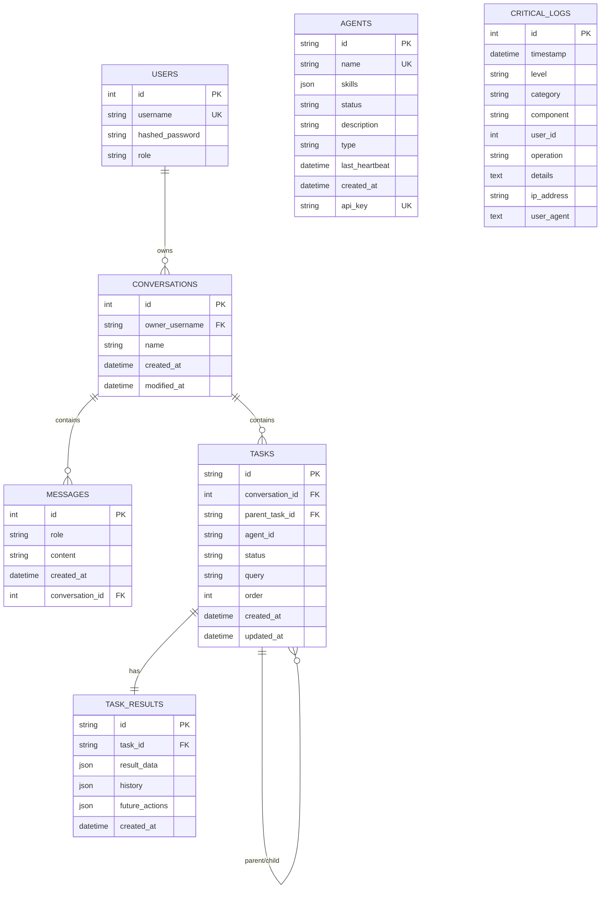

# Horus AI -- Data Model

This document describes the relational schema managed by the MAS Orchestrator via SQLAlchemy. All tables live in the PostgreSQL instance and are created at application startup. Schema migrations are handled by Alembic.

---

## Entity-Relationship Diagram

---

## Table Descriptions

### users

Stores system users with authentication credentials and role-based access.

| Column | Type | Constraints | Description |
|---|---|---|---|
| `id` | Integer | PK, auto-increment, indexed | Unique user identifier. |
| `username` | String | Unique, not null, indexed | Login name used for authentication. |
| `hashed_password` | String | Not null | Bcrypt-hashed password. Plaintext is never stored. |
| `role` | String | Not null, default `"user"` | One of `admin`, `manager`, `user`, or `system`. Governs RBAC permissions. |

**Relationships:**

- One user owns zero or more **conversations**. If a user is deleted, the `owner_username` on their conversations is set to `NULL` (SET NULL cascade).

**Indexes:** Primary key on `id`; unique index on `username` for fast authentication lookups.

---

### conversations

Represents a chat session between a user and the agent system.

| Column | Type | Constraints | Description |
|---|---|---|---|
| `id` | Integer | PK, auto-increment | Unique conversation identifier. |
| `owner_username` | String | FK -> `users.username`, nullable, indexed | The user who owns this conversation. Nullable to preserve conversations after user deletion. |
| `name` | String | Nullable | Optional human-readable label. |
| `created_at` | DateTime (tz) | Not null, server default `now()` | Timestamp of conversation creation. |
| `modified_at` | DateTime (tz) | Not null, server default `now()`, auto-update | Timestamp of the last modification to the conversation or its contents. |

**Relationships:**

- Belongs to one **user** (via `owner_username`).
- Contains zero or more **messages** (CASCADE delete -- removing a conversation removes all its messages).
- Contains zero or more **tasks** (CASCADE delete).

**Indexes:** Primary key on `id`; index on `owner_username`.

---

### messages

Individual messages within a conversation, storing both user inputs and agent responses.

| Column | Type | Constraints | Description |
|---|---|---|---|
| `id` | Integer | PK, auto-increment, indexed | Unique message identifier. |
| `role` | String | Not null | Sender role: `"user"`, `"assistant"`, or `"system"`. |
| `content` | String | Not null | The message text. |
| `created_at` | DateTime (tz) | Not null, server default `now()` | Timestamp of message creation. |
| `conversation_id` | Integer | FK -> `conversations.id`, not null, indexed | Parent conversation. |

**Relationships:**

- Belongs to one **conversation**. Deleted via CASCADE when the parent conversation is removed.

**Indexes:** Primary key on `id`; composite index on `(conversation_id, created_at)` for efficient chronological queries within a conversation.

---

### agents

Registry of AI agents available in the system. Agents register themselves and send periodic heartbeats so the orchestrator can track availability.

| Column | Type | Constraints | Description |
|---|---|---|---|
| `id` | String | PK | UUID assigned at registration. |
| `name` | String | Unique, not null, indexed | Human-readable agent name. |
| `skills` | JSON | Not null, default `[]` | List of capabilities the agent advertises (e.g., `["research", "summarize"]`). |
| `status` | String | Not null, default `"inactive"` | Current status: `"active"` or `"inactive"`. |
| `description` | String | Nullable | Free-text description of the agent's purpose. |
| `type` | Enum | Not null, default `"general"` | Agent specialization: `researcher`, `analyst`, `writer`, or `general`. |
| `last_heartbeat` | DateTime (tz) | Not null, server default `now()`, auto-update | Timestamp of the most recent heartbeat. Used for liveness detection. |
| `created_at` | DateTime (tz) | Not null, server default `now()` | Timestamp of agent registration. |
| `api_key` | String | Unique, not null | API key used by the agent to authenticate requests back to the MAS. |

**Relationships:**

- Agents are referenced by `tasks.agent_id` but there is no foreign key constraint, allowing agent records to be managed independently of task history.

**Indexes:** Primary key on `id`; unique indexes on `name` and `api_key`; index on `last_heartbeat`.

---

### tasks

A unit of work assigned to an agent within a conversation. Tasks support hierarchical decomposition via the self-referential `parent_task_id` column.

| Column | Type | Constraints | Description |
|---|---|---|---|
| `id` | String | PK | UUID generated at creation. |
| `conversation_id` | Integer | FK -> `conversations.id`, not null, indexed | Parent conversation this task belongs to. |
| `parent_task_id` | String | FK -> `tasks.id`, nullable | Optional parent task, enabling sub-task trees. |
| `agent_id` | String | Not null | ID of the agent assigned to execute this task. |
| `status` | Enum | Default `"pending"` | Lifecycle status: `pending`, `in_progress`, `completed`, `failed`, or `cancelled`. |
| `query` | String | Not null | The instruction or question the agent must process. |
| `order` | Integer | Nullable | Execution order hint for sibling tasks. |
| `created_at` | DateTime (tz) | Not null, server default `now()` | Task creation timestamp. |
| `updated_at` | DateTime (tz) | Not null, server default `now()`, auto-update | Last status change timestamp. |

**Relationships:**

- Belongs to one **conversation** (CASCADE delete).
- Optionally belongs to a **parent task**, forming a tree of sub-tasks.
- Has exactly one **task_result** (CASCADE delete).

**Indexes:** Primary key on `id`; index on `conversation_id`.

---

### task_results

Stores the output produced by a completed task, including the agent's answer, intermediate reasoning history, and suggested follow-up actions.

| Column | Type | Constraints | Description |
|---|---|---|---|
| `id` | String | PK | UUID generated at creation. |
| `task_id` | String | FK -> `tasks.id`, unique, not null | One-to-one link to the parent task. |
| `result_data` | JSON | Nullable | The agent's final answer payload. |
| `history` | JSON | Nullable | Record of intermediate ReAct reasoning steps (thoughts, actions, observations). |
| `future_actions` | JSON | Nullable | List of suggested follow-up actions the user or system could take. |
| `created_at` | DateTime (tz) | Not null, server default `now()` | Result creation timestamp. |

**Relationships:**

- Belongs to exactly one **task** (CASCADE delete). The unique constraint on `task_id` enforces the one-to-one relationship.

---

### critical_logs

Audit log table for high-priority system events, security incidents, and compliance records. All database CRUD operations are automatically logged here via SQLAlchemy event listeners.

| Column | Type | Constraints | Description |
|---|---|---|---|
| `id` | Integer | PK, auto-increment | Unique log entry identifier. |
| `timestamp` | DateTime (tz) | Not null, server default `now()` | When the event occurred. |
| `level` | String(20) | Not null | Log severity: `ERROR`, `CRITICAL`, `WARNING`, `INFO`. |
| `category` | String(20) | Not null | Event category: `SECURITY`, `AUTH`, `SYSTEM`, `DB`, etc. |
| `component` | String(50) | Not null | System component that generated the log (e.g., `auth`, `tasks`, `models`). |
| `user_id` | Integer | Nullable | ID of the user associated with the event, if applicable. |
| `operation` | String(100) | Not null | Description of the operation (e.g., `CREATE`, `UPDATE`, `DELETE`). |
| `details` | Text | Nullable | Extended information about the event. |
| `ip_address` | String(45) | Nullable | Client IP address (supports both IPv4 and IPv6). |
| `user_agent` | Text | Nullable | Browser or client user-agent string. |

**Relationships:**

- Standalone table with no foreign keys. References `user_id` by value for decoupling.

**Indexes:** Individual indexes on `timestamp`, `category`, `user_id`, `component`, and `operation` for efficient filtered queries.
