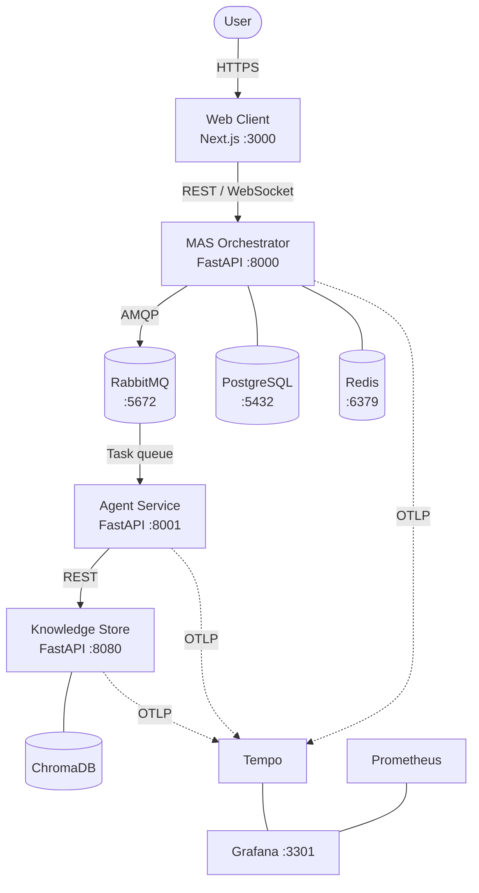
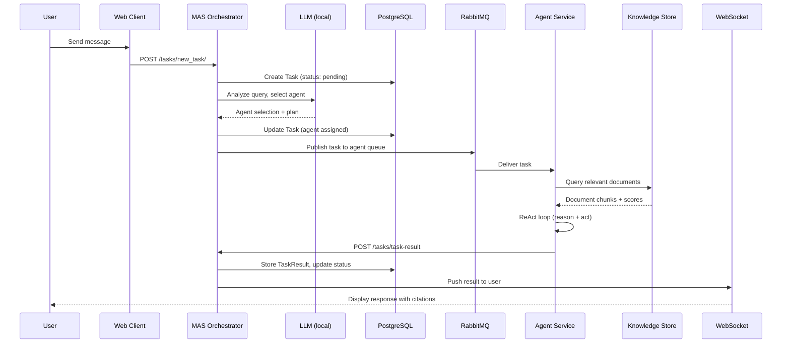
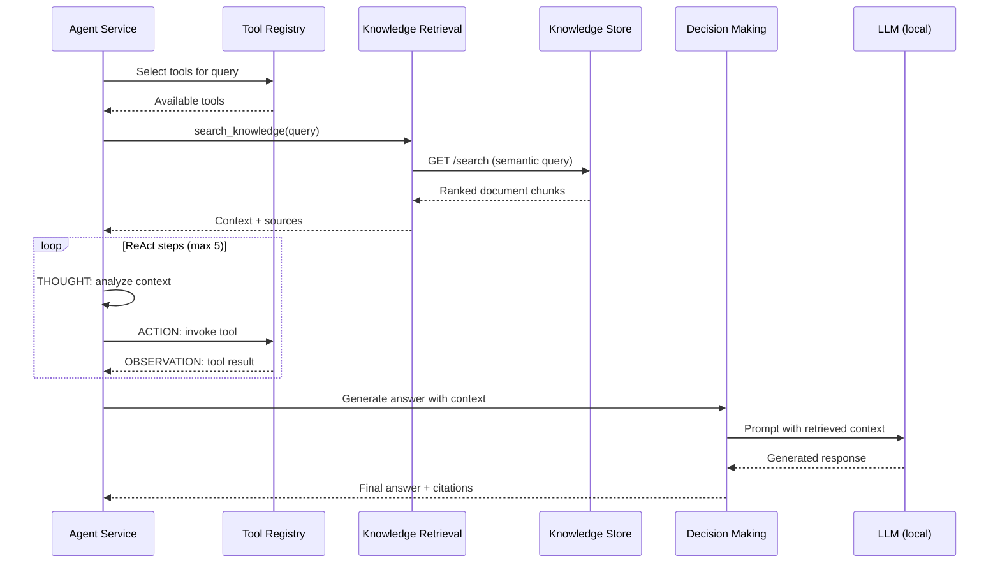
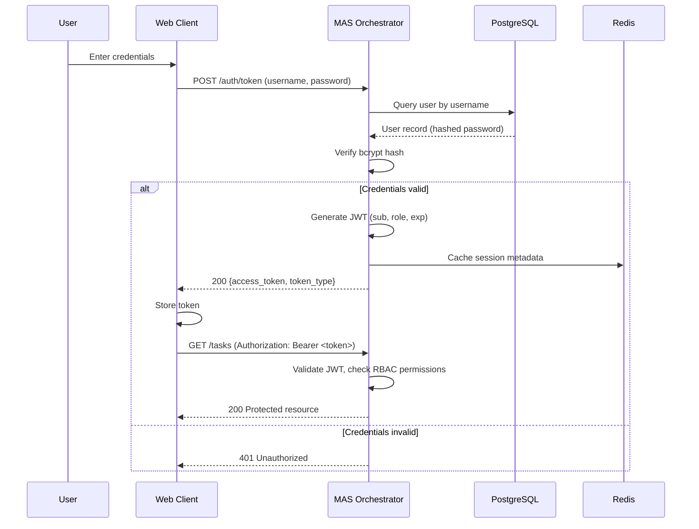
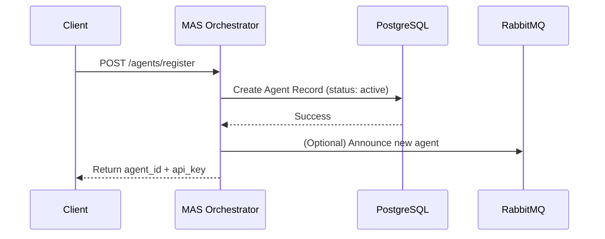
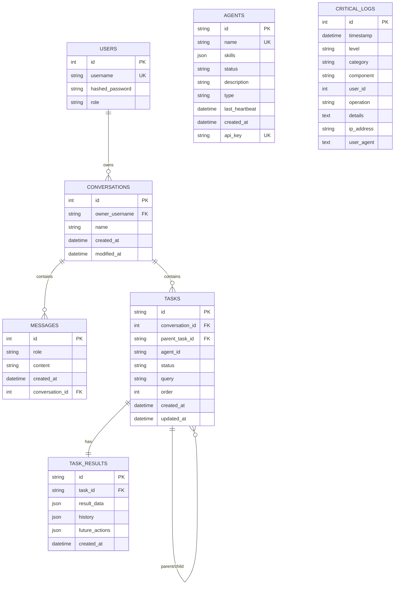

# Horus AI -- Architecture Overview

## Table of Contents

1. [System Overview](#1-system-overview)
2. [High-Level Architecture](#2-high-level-architecture)
3. [Service Descriptions](#3-service-descriptions)
4. [Data Flow Diagrams](#4-data-flow-diagrams)
5. [Persistence Topology](#5-persistence-topology)
6. [Configuration Contract](#6-configuration-contract)
7. [Technology Stack](#7-technology-stack)

---

## 1. System Overview

**Horus AI** is a self-hosted, privacy-first AI orchestration platform that enables organizations to run a multi-agent system entirely on their own infrastructure. No data leaves the company's servers; no external APIs are required.

### Problem

Organizations that want to leverage AI face three recurring concerns:

- **Data privacy** -- sensitive documents and queries are sent to third-party cloud services.
- **Cost** -- per-token pricing on commercial APIs scales unpredictably.
- **Vendor lock-in** -- tight coupling to a single provider limits flexibility and control.

### Solution

Horus AI addresses all three by providing:

- A **local deployment model** using Docker Compose (NVIDIA GPU when the toolkit is installed; CPU fallback via env) where every component runs on-premise.
- A **multi-agent architecture** where specialized AI agents (researcher, analyst, writer) collaborate under a central orchestrator to answer user queries.
- A **Retrieval-Augmented Generation (RAG) pipeline** that grounds every response in the organization's own documents stored in a private vector database.
- A **real-time chat interface** for end users, backed by WebSocket communication and JWT-based authentication with four-tier role-based access control.

### Key Capabilities

| Capability | Description |
|---|---|
| Private AI | All inference, storage, and orchestration run on-premise. |
| Multi-Agent Collaboration | Specialized agents are dispatched based on query analysis; tasks can be decomposed into sub-tasks. |
| RAG-Grounded Responses | Agents retrieve relevant document chunks from ChromaDB before generating answers, providing source citations. |
| Real-Time Chat | WebSocket-based streaming delivers responses to users as they are produced. |
| Role-Based Access Control | Four roles (Admin, Manager, User, System) with granular permissions govern every API endpoint. |
| Observability | Prometheus metrics, Grafana dashboards, distributed tracing via OpenTelemetry/Tempo, and structured JSON logging with correlation IDs. |

---

## 2. High-Level Architecture

The platform is composed of four application services, three persistence stores, a message broker, and an observability stack.

### Communication Protocols

| Path | Protocol | Purpose |
|---|---|---|
| User <-> Web Client | HTTPS | Browser traffic; static assets and API proxy |
| Web Client <-> MAS | REST (HTTP/1.1), WebSocket | API calls, real-time chat streaming |
| MAS <-> RabbitMQ | AMQP 0-9-1 | Asynchronous task dispatch and result delivery |
| RabbitMQ <-> Agent Service | AMQP 0-9-1 | Task consumption from dedicated queues |
| Agent Service <-> Knowledge Store | REST (HTTP/1.1) | Document search and file parsing requests |
| Knowledge Store <-> ChromaDB | ChromaDB Python client (embedded persistence in container) | Vector similarity search |
| All services -> Tempo | OTLP (gRPC) | Distributed trace export |
| Prometheus -> All services | HTTP scrape | Metrics collection |

---

## 3. Service Descriptions

### 3.1 MAS Orchestrator

**Port:** 8000 | **Runtime:** Python 3.13, FastAPI, Uvicorn

The MAS (Multi-Agent System) orchestrator is the central brain of the platform. It receives every user request, authenticates and authorizes it, decomposes complex queries into sub-tasks, and dispatches each sub-task to the appropriate agent via RabbitMQ.

**Responsibilities:**

- User authentication (OAuth2 password flow, JWT tokens, bcrypt password hashing)
- Role-based access control with four roles: Admin, Manager, User, System
- Agent registry management (registration, heartbeat tracking, status monitoring)
- Task decomposition using LLM-assisted query analysis
- Task dispatch via RabbitMQ and result aggregation
- Conversation and message persistence
- Real-time WebSocket communication with the web client
- Audit logging to the `critical_logs` table

**Internal Architecture:**

| Module | Responsibility |
|---|---|
| `auth/` | Authentication, JWT issuance/validation, API key verification, RBAC permissions |
| `agents/` | Agent registration, discovery, and heartbeat monitoring |
| `tasks/` | Task lifecycle management, decomposition, dispatch, and result collection |
| `conversations/` | Conversation CRUD, message history |
| `chat/` | Real-time WebSocket handler and message routing |
| `users/` | User management endpoints |
| `db/` | SQLAlchemy models, session management, Redis client, migrations |
| `core/` | Configuration, logging, metrics, tracing, RabbitMQ connection management, middleware |
| `schemas/` | Pydantic request/response models |

### 3.2 Agent Service

**Port:** 8001 | **Runtime:** Python 3.13, FastAPI, Uvicorn

The Agent Service hosts the AI agents that perform the actual reasoning and document retrieval. It consumes tasks from RabbitMQ, runs them through the RAG pipeline with a ReAct (Reasoning + Acting) loop, and posts results back to the MAS.

**Responsibilities:**

- Consuming tasks from RabbitMQ queues
- Running the RAG pipeline: knowledge retrieval, decision making, response generation
- ReAct agent loop (Thought -> Action -> Observation) for multi-step reasoning
- Tool execution: knowledge search, data extraction, file parsing, payment analysis, calculation, summarization
- Source citation in every response
- Posting task results back to the MAS orchestrator

**Internal Architecture:**

| Module | Responsibility |
|---|---|
| `agent_server/` | FastAPI app, task consumption endpoints, RabbitMQ listener |
| `ai_agents/rag_pipeline.py` | Orchestrates the full RAG flow: retrieval, reasoning, response |
| `ai_agents/react_agent.py` | ReAct loop with configurable max steps and timeout |
| `ai_agents/knowledge_retrieval_agent.py` | Queries the Knowledge Store for relevant document chunks |
| `ai_agents/decision_making_agent.py` | LLM-based decision making using retrieved context |
| `ai_agents/tool_registry.py` | Dynamic tool registration and dispatch |
| `ai_agents/calculator_tool.py` | Safe arithmetic evaluation |
| `ai_agents/data_extractor_tool.py` | Structured data extraction from documents |
| `ai_agents/file_parser_tool.py` | PDF, CSV, and text file parsing |
| `ai_agents/payment_analyzer_tool.py` | Domain-specific payment analytics |
| `ai_agents/summarizer_tool.py` | Text summarization |
| `ai_agents/knowledge_store_client.py` | HTTP client for the Knowledge Store API |
| `specialized/` | Pre-configured agent variants: researcher, analyst, writer |
| `config/` | Service-level configuration and model settings |
| `core/` | Logging, metrics, tracing |

### 3.3 Knowledge Store

**Port:** 8080 | **Runtime:** Python 3.13, FastAPI, Uvicorn

The Knowledge Store is the organization's private memory. It ingests documents (PDF, DOCX, TXT, CSV, images), chunks and embeds them into ChromaDB, and serves semantic search queries from the Agent Service.

**Responsibilities:**

- Document ingestion with automatic content analysis and chunking
- Embedding generation using SentenceTransformers
- Vector similarity search via ChromaDB
- File upload, storage, and lifecycle management
- Content type detection and format-specific parsing

**Internal Architecture:**

| Module | Responsibility |
|---|---|
| `api/routes/store.py` | Collection management and semantic search endpoints |
| `api/routes/file.py` | File upload, download, and deletion endpoints |
| `api/utils.py` | Request validation and response formatting |
| `chroma_db/setup.py` | ChromaDB client initialization and collection management |
| `chroma_db/models/` | Pydantic models for documents and search results |
| `chroma_db/services/file_service.py` | File processing pipeline |
| `services/content_analyzer.py` | Content type detection and metadata extraction |
| `services/document_chunker.py` | Recursive text splitting with configurable overlap |
| `core/` | Logging, metrics, correlation ID middleware |

### 3.4 Web Client

**Port:** 3000 | **Runtime:** TypeScript, Next.js 16, React 19

The Web Client is the user-facing application. It provides a real-time chat interface, document management, task monitoring, and an administration dashboard.

**Responsibilities:**

- User authentication (login, registration) with JWT token management
- Real-time chat via WebSocket with streaming responses
- Document upload to the Knowledge Store
- Task creation and lifecycle monitoring with sub-task tree visualization
- Agent status monitoring and collaboration visualization
- Admin dashboard for user, role, and agent management

**Internal Architecture:**

| Directory | Responsibility |
|---|---|
| `app/(protected)/` | Authenticated page routes: chat, dashboard, tasks, knowledge store, admin |
| `app/auth/` | Login and registration pages |
| `components/ui/` | Reusable UI primitives (button, card, input, sidebar, etc.) |
| `components/auth/` | Auth provider, protected route wrapper, password strength indicator |
| `components/tasks/` | Delegation chain, message flow, sub-task tree visualizations |
| `components/agents/` | Agent type badges, collaboration views |
| `lib/` | API client, auth/chat/agents/tasks/users API modules, type definitions, Zod schemas |
| `hooks/` | Custom hooks for WebSocket connection and mobile detection |
| `contexts/` | Notification context provider |
| `utils/` | Configuration, CSRF protection, formatting, local storage helpers |

---

## 4. Data Flow Diagrams

### 4.1 Task Lifecycle

A user submits a query through the chat interface. The MAS decomposes it, dispatches sub-tasks to agents via RabbitMQ, and streams the aggregated result back over WebSocket.

### 4.2 RAG Pipeline

When an agent processes a task, it follows a Retrieval-Augmented Generation pipeline with an optional multi-step ReAct reasoning loop.

### 4.3 Authentication Flow

Users authenticate via OAuth2 password flow. The MAS issues a JWT that the Web Client attaches to every subsequent request.

### 4.4 Agent Registration Flow

Agents register with the MAS to advertise their capabilities. The MAS stores the agent record and optionally announces its availability via RabbitMQ.

---

## 5. Persistence Topology

The persistence layer is built on PostgreSQL with SQLAlchemy as the ORM. The schema supports multi-agent orchestration, conversation history, task management, and audit logging.

### Entity-Relationship Diagram

See [data-model.md](data-model.md) for detailed table descriptions.

### Connection Lifecycle

#### PostgreSQL

- **Library:** SQLAlchemy (async-compatible)
- **Pool:** size=10, max overflow=20, timeout=30s, recycle=1800s
- **Session management:** A new `Session` is created per request via the `get_db` FastAPI dependency and closed when the request completes.
- **Monitoring:** Queries exceeding 500ms are logged automatically.

#### Redis

- **Library:** redis-py
- **Purpose:** Session caching, rate limiting, temporary data.
- **Lifecycle:** Managed via a connection pool; host, port, and password loaded from environment variables.

#### RabbitMQ

- **Library:** pika
- **Manager:** `core.rabbitmq_manager.RabbitMQ` handles connection, retry, and channel management.
- **Retry:** Exponential backoff with up to 500 retries for robust startup.
- **Heartbeat:** 600s keep-alive interval to maintain connection stability.

---

## 6. Configuration Contract

All services are configured via environment variables, typically set in `docker-compose.yml` or the `.env` file.

| Category | Variable | Required | Description |
|---|---|---|---|
| **Database** | `POSTGRES_USER` | Yes | PostgreSQL username |
| | `POSTGRES_PASSWORD` | Yes | PostgreSQL password |
| | `POSTGRES_DB` | Yes | Database name |
| | `DB_PORT` | Yes | PostgreSQL port (default: 5432) |
| **Auth** | `JWT_SECRET_KEY` | Yes | Secret key for signing JWT tokens |
| | `JWT_ALGORITHM` | Yes | Signing algorithm (default: HS256) |
| **Admin** | `SUPER_USER_USERNAME` | Yes | Initial admin username created at startup |
| | `SUPER_USER_PASSWORD` | Yes | Initial admin password |
| **Redis** | `REDIS_HOST` | Yes | Redis hostname |
| | `REDIS_PORT` | Yes | Redis port |
| | `REDIS_PASSWORD` | Yes | Redis password |
| **RabbitMQ** | `RABBITMQ_HOST` | Yes | RabbitMQ hostname |
| | `RABBITMQ_PORT` | Yes | RabbitMQ port |
| | `RABBITMQ_USER` | Yes | RabbitMQ username |
| | `RABBITMQ_PASSWORD` | Yes | RabbitMQ password |
| **Application** | `LLM_AUTOINIT` | No | Auto-initialize LLM on startup (0 or 1) |

A complete example with all variables is available at `src/infra/.env.example`.

---

## 7. Technology Stack

### Languages and Runtimes

| Technology | Version | Usage |
|---|---|---|
| Python | 3.13 | MAS Orchestrator, Agent Service, Knowledge Store |
| TypeScript | 5.9 | Web Client |
| SQL | -- | Database schema and migrations |

### Backend

| Technology | Purpose |
|---|---|
| FastAPI | REST API framework for all three Python services |
| Uvicorn | ASGI server |
| SQLAlchemy | ORM and database toolkit |
| Alembic | Database schema migrations |
| Pydantic | Request/response validation and settings management |
| python-jose | JWT token encoding/decoding |
| passlib + bcrypt | Password hashing |
| pika | RabbitMQ (AMQP) client |
| redis-py | Redis client |
| httpx | Async HTTP client for inter-service communication |

### Frontend

| Technology | Purpose |
|---|---|
| Next.js 16 | React framework with App Router |
| React 19 | UI component library |
| Tailwind CSS 4 | Utility-first styling |
| Mantine 8 | Component library |
| Radix UI | Accessible UI primitives |
| TanStack Query 5 | Server state management and caching |
| Zod | Runtime schema validation |
| Framer Motion | Animation library |
| Vitest | Unit testing |
| Playwright | End-to-end testing |

### AI / ML

| Technology | Purpose |
|---|---|
| Hugging Face Transformers | Model loading and inference |
| SentenceTransformers | Embedding generation for RAG |
| bitsandbytes | 4-bit model quantization for efficient GPU inference |
| ChromaDB | Vector database for document embeddings |

### Infrastructure

| Technology | Purpose |
|---|---|
| Docker / Docker Compose | Containerization and orchestration (`gpus: all` for LLM services when available) |
| PostgreSQL | Primary relational database |
| Redis | Caching, session storage |
| RabbitMQ | Asynchronous message broker for task dispatch |
| Prometheus | Metrics collection |
| Grafana | Dashboards and visualization |
| Tempo | Distributed trace backend |
| OpenTelemetry | Instrumentation SDK for traces and metrics export |

### Testing

| Technology | Purpose |
|---|---|
| pytest | Python unit and integration tests (async support) |
| Vitest | Frontend unit tests |
| Playwright | End-to-end browser tests |
| Locust | Load and performance testing |
| Custom resilience suite | Chaos testing for service failure scenarios |
