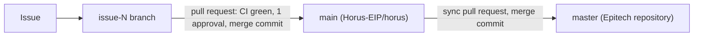

# CI and branches

How a change travels from a branch to the Epitech repository, and what CI checks on the way.\
How to send a change is in [CONTRIBUTING.md](../CONTRIBUTING.md); how the maintainers decide is in its section 7.

A pull request that adds, removes or changes a CI job, a workflow or a branch rule updates this page in the same pull request.

---

## The repositories and their branches

| Repository | Branch | What it is | How it changes |
|---|---|---|---|
| `Horus-EIP/horus` (private) | `main` | The working branch: every change lands here first. | Pull requests only, merged by a maintainer. |
| | `issue-<number>-<short-description>` | One branch per issue, in the repository or in a contributor's fork. | Its author pushes to it. GitHub deletes it after the merge (branches in a fork are deleted by their owner). |
| `EpitechPromo2027/G-EIP-600-BAR-6-1-eip-loup.marquez` (Epitech) | `master` | The graded copy: what the jury and the mentor read. | Sync pull requests from `main` only (below). Nobody commits there directly. |
| | `archive/Year_2025-2026` | The branches of the 2025–2026 school year, gathered into one when the repository was cleaned up in September 2026. | Nobody: it is frozen. |
| `Horus-EIP/horus-bench-kit` (public) | `main` | The open-source benchmark and evaluation kit. | Pull requests; its ruleset makes GitHub enforce one approval and green CI ([The benchmark kit](../CONTRIBUTING.md#the-benchmark-kit)). |

In a clone, `origin` is `Horus-EIP/horus` and `epitech` is the Epitech repository.



---

## Merge commits, never squash

Every pull request, in every repository, is merged with **Create a merge commit**. Squash and rebase merging are turned off in `Horus-EIP/horus`.

- **The changelog cites commit ids.** A squash merge writes a new commit and leaves the pull request's own commits out of the branch, so the ids `CHANGELOG.md` cites would no longer be in its history.
- **It keeps who wrote what.** Every commit keeps its author, which `CONTRIBUTORS.md` and the who-made-what documents rely on.
- **It's why we stopped squashing.** Until September 2026 the Epitech repository squash-merged its pull requests; the commits of those pull requests are now reachable only through the pull requests themselves.

---

## From `main` to the Epitech `master`: the sync pull request

After a batch of merged work (for example after the weekly meeting, or before a follow-up with the mentor), one maintainer sends `main` to the Epitech repository:

```bash
git switch main
git pull --ff-only origin main
git push epitech main:sync/2026-10-20
```

1. In the Epitech repository, open a pull request from `sync/<date>` to `master`. Its description lists the pull requests of `Horus-EIP/horus` it brings.
2. Another maintainer reviews it, as for any pull request; CI runs in the Epitech repository too.
3. Merge it with **Create a merge commit**, then delete the `sync/<date>` branch.

The sync merge commit stays in `master`: it carries no change of its own, so `main` doesn't need it, and the next sync pull request merges cleanly without it. `main` changes only through pull requests in `Horus-EIP/horus`.

---

## What CI runs

The workflows are in `.github/workflows/`; each sync pull request brings the same files to the Epitech `master`.

| Workflow | Runs on | What for |
|---|---|---|
| `ci.yml` | Every push to `main` or `master`, every pull request, and by hand | The jobs below |
| `eval-testset.yml` | The same, but only when the evaluation files change: `demo_assets/`, `tests/eval/`, `scripts/eval/`, `scripts/benchmarks/`, the two benchmark scripts in `scripts/perf/`, the bench kit or the workflow itself | **Tests · Eval test set:** the test set, its runner and the bench kit's tests |
| `images.yml`, `desktop-release.yml` | A `v*` tag, and by hand | The release: service images, source bundles and the desktop app ([VERSIONING.md](../VERSIONING.md)); RC tags also run the full GPU evaluation on a `horus-gpu-8gb` self-hosted runner when one is registered |

On a pull request, a new push cancels the run still going for that pull request; runs on `main` and `master` are never cancelled. A pull request from a fork waits until a maintainer clicks **Approve workflows to run**, at every push.

### The jobs of `ci.yml`

| Job | What it checks |
|---|---|
| Lint (ruff) | `ruff check` (ruff 0.16.6) on `src`, `tests`, `scripts`, `installer`, `packaging` and `opensource`. |
| Security (bandit) | bandit 1.9.4 on `src/`, `installer/` and `scripts/`, without the tests and `scripts/integration-checks/`. Every finding goes to the job summary; the job fails on a high-severity one. |
| Version numbers match VERSION | The `tests/ci` suite, then every version number in the repository against `VERSION`. |
| Licences | `THIRD_PARTY_NOTICES` is up to date, and there is no GPL, AGPL or SSPL licence among the Python packages, the web client and the desktop app. |
| Bench kit (standalone, Python 3.10 and 3.13) | The kit installed on its own, its tests, its zip, and no Horus content in it. |
| CPU build wiring | The torch pin, the Dockerfiles, the CPU overlay and the image job. |
| CPU image · mas, agent, knowledge_store | Each image builds through the CPU overlay, with no CUDA package and no torch; its size and build time go to the job summary. |
| Tests · MAS, Agent, Knowledge Store, Installer, LLM mock | Each part's tests with coverage, on the images' Python (`src/services/PYTHON_VERSION`). Minimum coverage, lines and branches: 85 %, 90 %, 85 %, none and 90 % ([TESTING.md](../TESTING.md)). LLM mock also runs the contract tests. When MAS, Agent or Knowledge Store fails, the job uploads its coverage and test reports, kept 3 days; Installer and LLM mock upload nothing. |
| End to end · mock AI | The whole stack in mock AI mode, with no model: the demo documents uploaded and `installer/smoke.py` run ([docs/mock-ai.md](mock-ai.md)). It took 7 to 10 minutes in our runs; the job is stopped after 40 (`timeout-minutes`). |
| Coverage summary | One table with the coverage of the five test suites, in the run's summary. |

### Not in CI yet

| Check | Issue |
|---|---|
| The web client: typecheck and vitest, then lint | B-40, [#17](https://github.com/Horus-EIP/horus/issues/17) |
| `ruff format --check` | B-41, [#18](https://github.com/Horus-EIP/horus/issues/18) |
| mypy | B-43, [#20](https://github.com/Horus-EIP/horus/issues/20) |
| The integration checks in `scripts/integration-checks/`, which need a live stack | B-115, [#23](https://github.com/Horus-EIP/horus/issues/23) |

### What GitHub enforces

On `Horus-EIP/horus`, nothing: GitHub Free can't require checks or reviews on a private repository. We hold ourselves to it: merge only when every job is green and a maintainer has approved ([How we merge](../CONTRIBUTING.md#how-we-merge)). On the public bench kit, its ruleset does enforce both.

---

## The benchmark kit sync (`sync-bench-kit.yml`)

Every day at 06:23 UTC, and by hand, this workflow copies `Horus-EIP/horus-bench-kit` (`main`) into `opensource/horus-bench-kit/` with `rsync --delete`, so a file removed from the kit is removed here. It never pushes to `main`: it force-pushes the branch `automation/sync-horus-bench-kit` and opens or updates one pull request. Nothing changes in `main` until a maintainer merges that pull request.

| Question | Decision |
|---|---|
| Who owns `HORUS_SYNC_TOKEN`, and what can it write? | One maintainer of `Horus-EIP`, who creates it as a fine-grained personal access token and stores it as a repository secret. It is limited to the repository `Horus-EIP/horus`, with **Contents: read and write** and **Pull requests: read and write**, and nothing else. It expires within 90 days and its owner renews it. A leaked token could push branches, never merge: `main` changes only through a reviewed pull request. |
| Does it replace the subtree process? | Yes. This workflow is now the normal way the kit comes back into `Horus-EIP/horus`. The `git subtree pull` in [CONTRIBUTING.md](../CONTRIBUTING.md#the-benchmark-kit) stays as a manual fallback when the workflow is down. The kit is still changed in its own repository first, never in `opensource/`. |
| Who reviews the sync pull requests? | The pull request is opened with the token, so it is authored by the token's owner, who cannot approve it. Another maintainer reviews and merges it ([How we merge](../CONTRIBUTING.md#how-we-merge)): they read the diff of `opensource/horus-bench-kit/`, check that it only brings changes already merged in the kit repository, and wait for green CI. |

The commit is made as `github-actions[bot]` and names the upstream kit commit in its message; it has no co-author.
